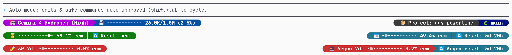

# agy-powerline

[English](README.md) | [简体中文](README.zh-CN.md) | [日本語](README.ja.md) | [Français](README.fr.md) | [Español](README.es.md) | [한국어](README.ko.md) | **Deutsch**

[](https://www.npmjs.com/package/agy-powerline)
[](https://www.npmjs.com/package/agy-powerline)
[](https://github.com/wassim-azi/agy-powerline/stargazers)
[](https://github.com/wassim-azi/agy-powerline/actions/workflows/ci.yml)
[](https://github.com/wassim-azi/agy-powerline/actions/workflows/codeql.yml)
[](https://scorecard.dev/viewer/?uri=github.com/wassim-azi/agy-powerline)
[](https://www.bestpractices.dev/projects/15655)
[](#datenschutz-und-sicherheit)
[](docs/install.md)
[](https://opensource.org/licenses/MIT)
[](https://codespaces.new/wassim-azi/agy-powerline?quickstart=1)
[](https://agy-powerline.com/configure/)
[](https://github.com/Piebald-AI/awesome-gemini-cli)

> **Hinweis:** Diese Übersetzung ist möglicherweise nicht auf dem neuesten Stand. Bei Abweichungen gilt die [englische Originalversion](README.md). Die ausführliche Dokumentation ([`docs/`](docs/)) ist nur auf Englisch verfügbar.

**Eine schnelle, konfigurierbare agy-Statuszeile für die Google Antigravity CLI (`agy`).**

Behalte Modell, Google-Gemini- (Hydrogen, Neon, Argon, Carbon, Flash) und Anthropic-Kontingente (Claude, Sonnet), Kontextfenster, Git-Branch und vieles mehr auf einen Blick im Auge. Wähle Widgets, Themes und Layout in einem interaktiven Editor. Ein Befehl zur Installation, keine Abhängigkeiten.

<p align="center">
  
</p>

## Warum agy-powerline?

| Funktion                   | Was du bekommst                                                                                                | Mehr erfahren                                                                                                 |
| -------------------------- | -------------------------------------------------------------------------------------------------------------- | ------------------------------------------------------------------------------------------------------------- |
| Kontingent-Tempo           | Tempomarkierungen auf den Anzeigen zeigen, ob dein 5h- oder 7T-Kontingent bis zum Reset ausreicht              | [Kontingent-Guide](docs/guides/antigravity-quota.md) · [Rechner](https://agy-powerline.com/quota-calculator/) |
| Mehrere Anbieter           | Google Gemini (Hydrogen, Neon, Argon, Carbon, Flash) und Anthropic (Claude, Sonnet) nebeneinander verfolgen    | [Payload-Referenz](docs/payload.md#quota-buckets)                                                             |
| Themes & Layouts           | 22 WCAG-AA-geprüfte Themes (dunkel, hell und farbenblindfreundlich) für `pills`, `lines` und `classic`         | [Theme-Galerie](https://agy-powerline.com/themes/)                                                            |
| Interaktive Konfiguratoren | Editor mit Live-Vorschau im Terminal (`npx agy-powerline`) oder im Browser                                     | [Web-Konfigurator](https://agy-powerline.com/configure/)                                                      |
| Sicherheit & Datenschutz   | Null Laufzeitabhängigkeiten, keine Netzwerkaufrufe, keine Telemetrie, automatische Backups von `settings.json` | [Sicherheit](SECURITY.md)                                                                                     |
| Plattformübergreifend      | Läuft unter Windows, macOS, Linux und WSL mit integrierter Diagnose (`doctor`)                                 | [Installation](docs/install.md) · [Fehlerbehebung](docs/troubleshooting.md)                                   |

## Installation

Du benötigst [Node.js](https://nodejs.org/) 20+ und die [Antigravity CLI](https://antigravity.google/docs/cli/overview). Läuft unter Windows, macOS, Linux und WSL ([WSL-Hinweise](docs/install.md#wsl)).

```bash
npx agy-powerline             # Statuszeile installieren und den Editor öffnen
agy                           # Antigravity starten
```

Im Terminal installiert `npx agy-powerline` die Skripte (oder aktualisiert veraltete Skripte unter Beibehaltung deiner Konfiguration), trägt die Statuszeile in Antigravitys `settings.json` ein (nach einem Backup und einer Rückfrage vor dem Ersetzen einer bestehenden `statusLine`) und öffnet direkt den Editor mit Live-Vorschau. Starte `agy` danach einmal neu. Für nicht-interaktive oder skriptgesteuerte Installationen nutze `npx agy-powerline init --yes`. Details: [wie die Installation funktioniert](docs/install.md).

<details>
<summary>Screenshot: die Leiste in einer echten agy-Sitzung (Windows Terminal)</summary>

<p align="center">
  
</p>

</details>

### Direkt aus agy heraus installieren

agy-powerline ist auch ein agy-Plugin. Füge es hinzu und führe dann seinen Setup-Skill in einer `agy`-Sitzung aus; er übernimmt `init` und `doctor` für dich:

```text
agy plugin install https://github.com/wassim-azi/agy-powerline
/agy-powerline-setup
```

Starte `agy` danach einmal neu. Details: [Installation als Plugin](docs/install.md#install-from-inside-agy-plugin).

Oder füge diese Anweisung in eine `agy`-Sitzung ein:

```text
Install the agy-powerline statusline: run `npx agy-powerline init --yes`, then tell me to restart agy.
```

`--yes` überspringt Rückfragen, die agy nicht beantworten kann, und ersetzt eine vorhandene `statusLine` nach einem Backup von `settings.json`.

Für ein Terminal ohne Nerd Font lässt sich der ASCII-Modus aktivieren (`Settings` über `i` in `npx agy-powerline`).

## Anpassung

`npx agy-powerline` öffnet einen Editor mit Live-Vorschau deiner Statuszeile. Wechsle mit `←` `→` zwischen Widgets, Presets, Themes, Layout, Powerline und Settings, navigiere mit `↑` `↓`, wähle mit Enter aus und speichere und beende mit `q`. Die Tasten für jeden Bildschirm stehen unten; die vollständige Liste findest du unter [Konfiguration](docs/configuration.md#configurator-keys).

Lieber im Browser? [Stelle deine Leiste im Browser zusammen](https://agy-powerline.com/configure/) – mit Live-Vorschau zum Herunterladen oder Importieren.

Änderungen werden in einer laufenden `agy`-Sitzung bei der nächsten Aktualisierung übernommen.

### Vorlagen (Presets)

Starte mit einer Vorlage und passe sie nach Bedarf an:

| Vorlage   | Zeigt                                                                                               |
| --------- | --------------------------------------------------------------------------------------------------- |
| `default` | Modell, Kontext, Git; 5h- und 7T-Kontingente mit Reset-Zeiten in einer zweiten Zeile                |
| `compact` | Eine Zeile: kurzer Modellname, knappstes Kontingent, Kontext-%, Git                                 |
| `agent`   | Agent-Status, Subagenten, Titel, Modus, Sandbox; Modell, Kontext-%, Artefakte, knappstes Kontingent |
| `git`     | Projekt, Branch, Worktree, Stash; Dateianzahl, Zeilenänderungen, Commit                             |
| `tokens`  | Kontext-Tokens, Sitzungs-Tokens (ein/aus), Cache-Hit; Tokens heute und über 7 Tage                  |
| `quotas`  | Tarif und Modell; 5h- und 7T-Kontingente nebeneinander; Drittanbieter und Argon darunter            |
| `full`    | Alles: Sitzung, Projekt und Git; Kontext, Tokens und Cache; beide Kontingente                       |

### Themes

| Terminal-Hintergrund  | Themes                                                                                                                                                                                                                                                        |
| --------------------- | ------------------------------------------------------------------------------------------------------------------------------------------------------------------------------------------------------------------------------------------------------------- |
| Dunkel                | `dark-aurora` (Standard), `dark-ocean`, `dark-ember`, `dark-forest`, `dark-neon`, `dark-mono`, `dark-dracula`, `dark-onyx`, `dark-tokyo-night`, `dark-catppuccin-macchiato`, `dark-catppuccin-frappe`, `dark-catppuccin-mocha`, `dark-nord`, `dark-rose-pine` |
| Hell                  | `light-paper`, `light-sky`, `light-sunset`, `light-cream`, `light-gruvbox`, `light-tokyo-night`                                                                                                                                                               |
| Farbenblindfreundlich | `colorblind-dark`, `colorblind-light`                                                                                                                                                                                                                         |
| Eigene Farben         | `custom` ([Anleitung](docs/configuration.md#custom-theme))                                                                                                                                                                                                    |

Sieh dir alle Themes in der [Theme-Galerie](https://agy-powerline.com/themes/) oder mit `npx agy-powerline theme --gallery` an. Für einen durchgehenden Farbverlauf über jede Zeile kannst du einen Gradient hinzufügen: `npx agy-powerline gradient <name>` mit `aurora`, `sunset`, `ocean`, `forest`, `neon`, `candy`, `rainbow`, `mono` oder deinen eigenen Farben ([Anleitung](docs/configuration.md#gradients)).

### Layouts

**Pills** (Standard): Kapseln im Powerline-Stil. Wähle zwischen abgerundeten, eckigen, abgeschrägten oder flachen Formen sowie optional einer Leerzeile zwischen den Zeilen.

<p align="center">
  
</p>

<details>
<summary>Auf einem hellen Terminal</summary>

<p align="center">
  
</p>

</details>

**Lines**: dieselben Informationen als schlichter farbiger Text.

<p align="center">
  
</p>

<details>
<summary>Auf einem hellen Terminal</summary>

<p align="center">
  
</p>

</details>

**Classic**: schlichter farbiger Text mit `|`-Trennzeichen und Blockanzeigen wie `███░│░░░░░`.

<p align="center">
  
</p>

<details>
<summary>Auf einem hellen Terminal</summary>

<p align="center">
  
</p>

</details>

### Sprache der Statuszeile

Die eigenen Bezeichnungen der Leiste (`Kontingent`, `7T`, `übr.`, die Einheiten in `1T 17h`) lassen sich auf Deutsch anzeigen:

```sh
npx agy-powerline init --language de
```

oder `"language": "de"` in `statusline.config.json` (Tab `Settings` über `i` im interaktiven Editor). Modellname, Branch und alles, was agy übergibt, bleiben unverändert; die CLI-Befehle und der interaktive Editor bleiben auf Englisch. Details in der [Konfigurationsdokumentation](docs/configuration.md#language).

## Widgets

| Widget                                                           | Zeigt                                                                                                                        |
| ---------------------------------------------------------------- | ---------------------------------------------------------------------------------------------------------------------------- |
| `model`                                                          | Das aktuell verwendete Modell                                                                                                |
| `clock`                                                          | Aktuelle Ortszeit (12/24-Stunden-Format unter `clock` einstellbar)                                                           |
| `fiveHourBar`, `weeklyBar`                                       | Verbleibendes 5h- / 7T-Kontingent als Anzeige mit [Tempomarkierung](docs/configuration.md#quota-pace-marker)                 |
| `fiveHourPct`, `weeklyPct`                                       | Verbleibendes 5h- / 7T-Kontingent in Prozent                                                                                 |
| `fiveHourReset`, `weeklyReset`                                   | Verbleibende Zeit bis zum Reset des Kontingents oder die Reset-Uhrzeit                                                       |
| `quota`                                                          | Das Kontingent, das am nächsten an der Erschöpfung liegt, samt Reset                                                         |
| `thirdPartyFiveHour`, `thirdPartyWeekly`                         | Kontingente für Drittanbieter-Modelle                                                                                        |
| `argonWeekly`, `argonReset`                                      | Eigenes Wochenkontingent von Gemini 4 Argon (Google AI Pro) und dessen Reset                                                 |
| `context`, `contextPct`, `contextTokens`                         | Genutztes Kontextfenster: Anzeige, Prozentsatz oder Token-Anzahl                                                             |
| `git`                                                            | Branch, nicht committete Änderungen sowie Commits voraus/zurück (ahead/behind)                                               |
| `gitChanges`, `gitFiles`, `gitSha`, `gitStash`, `gitWorktree`    | Hinzugefügte/gelöschte Zeilen, gestagte/geänderte/ungetrackte/konfliktbehaftete Dateien, Commit-ID, Stashes, Worktree        |
| `project`, `cwd`                                                 | Projektordner, aktueller Ordner                                                                                              |
| `agent`, `agentState`, `plan`, `sandbox`, `artifacts`, `version` | Aktiver Agent, Agent-Status (mit Bestätigungs-Flag), Tarif, Sandbox, Artefakte, CLI-Version                                  |
| `tasks`, `queue`                                                 | Laufende Subagenten, Hintergrundaufgaben, eingereihte Benutzernachrichten                                                    |
| `mode`                                                           | Bestätigungsmodus (z. B. `accept-edits`) und Vim-Modus                                                                       |
| `title`                                                          | Titel der aktuellen Unterhaltung                                                                                             |
| `sessionTime`                                                    | Verstrichene Zeit seit Beginn der aktiven Unterhaltung                                                                       |
| `totalTokens`, `cost`, `cacheHit`, `cacheRead`, `cacheCreate`    | Sitzungs-Tokens, geschätzte Kosten (USD) und Nutzung des Prompt-Caches                                                       |
| `tokensToday`, `tokensWeek`, `tokensMonth`                       | Heute, in den letzten 7 Tagen und in den letzten 30 Tagen genutzte Tokens über alle Unterhaltungen hinweg (Node 22.13+)      |
| `ram`                                                            | Belegter Arbeitsspeicher auf deinem Rechner                                                                                  |
| `os`                                                             | System, auf dem agy läuft: Windows, macOS, Linux oder WSL                                                                    |
| `host`                                                           | Aktueller Benutzer und kurzer Hostname des Betriebssystems (`alex@devbox`)                                                   |
| `customText`, `env`, `exec`                                      | Eigener Text, eine Umgebungsvariable oder die Ausgabe eines [Shell-Befehls](docs/configuration.md#shell-command-widget-exec) |

Ein Widget ohne anzuzeigende Daten blendet sich automatisch aus. Widgets lassen sich umfärben, umbenennen, mit einem anderen Icon versehen, ohne Label darstellen oder mit eigenen Warnschwellen versehen: siehe [Konfiguration](docs/configuration.md).

## Befehle

| Befehl                                             | Funktion                                                                         |
| -------------------------------------------------- | -------------------------------------------------------------------------------- |
| `npx agy-powerline`                                | Installieren (falls nötig), veraltete Skripte aktualisieren und Editor öffnen    |
| `npx agy-powerline init [--yes]`                   | Statuszeile installieren oder aktualisieren (unterstützt `--preset`, `--yes`, …) |
| `npx agy-powerline configure`                      | Den Editor öffnen (veraltet; Alias `config` – nutze `npx agy-powerline`)         |
| `npx agy-powerline preset <name>`                  | Eine Vorlage anwenden (`--list` zeigt alle an)                                   |
| `npx agy-powerline theme <name>`                   | Theme wechseln (`--list`, `--gallery`)                                           |
| `npx agy-powerline gradient <name>`                | Jede Zeile mit einem Farbverlauf einfärben (`--list`, `off`)                     |
| `npx agy-powerline layout <pills\|lines\|classic>` | Layout wechseln                                                                  |
| `npx agy-powerline caps <style>`                   | Kapselform wechseln: `round`, `angled`, `slanted`, `flat`                        |
| `npx agy-powerline export [file]`                  | Konfiguration in eine Datei speichern, zum Sichern oder Teilen                   |
| `npx agy-powerline import <file>`                  | Konfiguration nach Anzeige der Änderungen laden (`--merge`)                      |
| `npx agy-powerline doctor`                         | Installation prüfen und gefundene Probleme erklären                              |
| `npx agy-powerline report`                         | Datenschutzfreundlichen Fehlerbericht erstellen                                  |
| `npx agy-powerline uninstall [--delete]`           | Aus agy entfernen (`--delete` löscht auch die zugehörigen Dateien)               |
| `npx agy-powerline render --demo`                  | Die Leiste mit Beispieldaten ausgeben                                            |

Rufe einen beliebigen Befehl mit `--help` auf, um alle Optionen zu sehen.

## Aktualisierung

```bash
npx agy-powerline init --yes   # Skripte der neuen Version installieren
npx agy-powerline doctor       # prüfen, ob alles auf dem neuesten Stand ist
```

Deine Einstellungen bleiben erhalten. Starte `agy` anschließend neu.

## Fehlerbehebung

Führe zuerst `npx agy-powerline doctor` aus: Der Befehl prüft die Installation und zeigt dir, wie gefundene Probleme behoben werden können. Häufige Probleme und Hinweise zum Melden von Fehlern: [Fehlerbehebung](docs/troubleshooting.md).

## Datenschutz und Sicherheit

- **Keine Netzwerkaufrufe, keine Telemetrie.** Alle Angaben stammen aus den Daten, die agy an die Statuszeile übergibt, aus `.git` und von deinem Betriebssystem. Der einzige externe Link ist `g` im interaktiven Editor, womit die GitHub-Seite im Browser geöffnet wird.
- **Deine Einstellungen sind sicher.** `init` und `uninstall` legen ein Backup von `settings.json` an und verweigern Änderungen an einer Datei, die nicht geparst werden kann.
- **Nichts wird ausgeführt, was du nicht selbst hinzufügst.** Abgesehen von kurzen `git`-Aufrufen für Ahead/Behind-Zähler sowie die Datei- und Zeilenzähler der von dir hinzugefügten Git-Widgets führt die Leiste ausschließlich Befehle aus `exec`-Widgets aus, die du selbst konfigurierst.
- **Null Laufzeitabhängigkeiten**, veröffentlicht aus der CI mit [npm-Provenance-Nachweis](https://docs.npmjs.com/generating-provenance-statements).

Alle Details: [SECURITY.md](SECURITY.md).

## Mitwirken

Beiträge sind herzlich willkommen. Lies zuerst [CONTRIBUTING.md](CONTRIBUTING.md) (Entwicklungsumgebung, Architektur, Hinzufügen eines Widgets oder Themes) und den [Verhaltenskodex](CODE_OF_CONDUCT.md). Öffne Pull Requests gegen `main`. Melde Fehler über [GitHub Issues](https://github.com/wassim-azi/agy-powerline/issues) oder teile Ideen und Feedback in den [Discussions](https://github.com/wassim-azi/agy-powerline/discussions).

Vielen Dank an alle, die beigetragen haben:

<!-- ALL-CONTRIBUTORS-LIST:START - Do not remove or modify this section -->
<!-- prettier-ignore-start -->
<!-- markdownlint-disable -->
<table>
  <tbody>
    <tr>
      <td align="center" valign="top" width="20%"><a href="https://github.com/yatharth2soni"><br /><sub><b>Yatharth&nbsp;Soni</b></sub></a></td>
      <td align="center" valign="top" width="20%"><a href="https://github.com/dannyward630"><br /><sub><b>Danny&nbsp;Ward</b></sub></a></td>
      <td align="center" valign="top" width="20%"><a href="https://github.com/yoreva-01"><br /><sub><b>Yusuf&nbsp;Orçan</b></sub></a></td>
      <td align="center" valign="top" width="20%"><a href="https://github.com/yuefdev"><br /><sub><b>Yusuf&nbsp;Efe</b></sub></a></td>
      <td align="center" valign="top" width="20%"><a href="https://github.com/hiyouwhatsapp"><br /><sub><b>hiyouwhatsapp</b></sub></a></td>
    </tr>
    <tr>
      <td align="center" valign="top" width="20%"><a href="https://github.com/dharamdan01"><br /><sub><b>dharamdan01</b></sub></a></td>
      <td align="center" valign="top" width="20%"><a href="https://github.com/Ashuge11"><br /><sub><b>Ashvini&nbsp;Sundge</b></sub></a></td>
      <td align="center" valign="top" width="20%"><a href="https://www.unkletayo.dev/"><br /><sub><b>Adetayo&nbsp;Akinsanya</b></sub></a></td>
      <td align="center" valign="top" width="20%"><a href="https://github.com/rahul05ranjan"><br /><sub><b>Rahul</b></sub></a></td>
      <td align="center" valign="top" width="20%"><a href="https://github.com/Logic769"><br /><sub><b>Logic769</b></sub></a></td>
    </tr>
  </tbody>
</table>

<!-- markdownlint-restore -->
<!-- prettier-ignore-end -->

<!-- ALL-CONTRIBUTORS-LIST:END -->

Wenn dir agy-powerline weiterhilft, hilft ein ⭐ anderen agy-Nutzerinnen und -Nutzern, das Projekt zu finden.

## Star History

[](https://star-history.com/#wassim-azi/agy-powerline&Date)

## Lizenz

[MIT](LICENSE) © Wassim AZI
