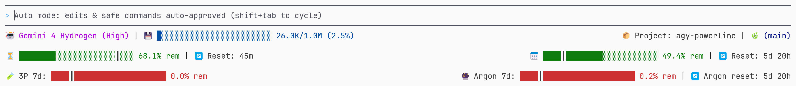

<div align="center">

# agy-powerline

[English](README.md) | [简体中文](README.zh-CN.md) | [日本語](README.ja.md) | [Français](README.fr.md) | **Español** | [한국어](README.ko.md) | [Deutsch](README.de.md)

[](https://www.npmjs.com/package/agy-powerline)
[](https://www.npmjs.com/package/agy-powerline)
[](https://github.com/wassim-azi/agy-powerline/stargazers)
[](https://github.com/wassim-azi/agy-powerline/actions/workflows/ci.yml)
[](https://github.com/wassim-azi/agy-powerline/actions/workflows/codeql.yml)
[](https://scorecard.dev/viewer/?uri=github.com/wassim-azi/agy-powerline)
[](#privacidad-y-seguridad)
[](docs/install.md)
[](https://opensource.org/licenses/MIT)
[](https://agy-powerline.com/configure/)
[](https://github.com/Piebald-AI/awesome-gemini-cli)

> **Nota:** esta traducción puede no estar actualizada. En caso de discrepancia, la [versión en inglés](README.md) prevalece. La documentación detallada ([`docs/`](docs/)) solo está disponible en inglés.

**Una línea de estado rápida y configurable para la CLI de Google Antigravity (`agy`).**

Consulta de un vistazo tu modelo, las cuotas de Google Gemini (Hydrogen, Neon, Argon, Carbon, Flash) y Anthropic (Claude, Sonnet), la ventana de contexto, la rama de Git y mucho más. Elige widgets, temas y diseño desde un editor interactivo. Un solo comando para instalar, sin dependencias.

</div>

<p align="center">
  
</p>

## ¿Por qué agy-powerline?

| Característica               | Qué obtienes                                                                                                      | Más información                                                                                                 |
| ---------------------------- | ----------------------------------------------------------------------------------------------------------------- | --------------------------------------------------------------------------------------------------------------- |
| Ritmo de cuotas              | Los marcadores de ritmo en los medidores muestran si tu cuota de 5h o 7d durará hasta su reinicio                 | [Guía de cuotas](docs/guides/antigravity-quota.md) · [Calculadora](https://agy-powerline.com/quota-calculator/) |
| Cuotas de varios proveedores | Sigue lado a lado las cuotas de Google Gemini (Hydrogen, Neon, Argon, Carbon, Flash) y Anthropic (Claude, Sonnet) | [Referencia del payload](docs/payload.md#quota-buckets)                                                         |
| Temas y diseños              | 22 temas con contraste WCAG AA (oscuros, claros y aptos para daltonismo) en `pills`, `lines` y `classic`          | [Galería de temas](https://agy-powerline.com/themes/)                                                           |
| Configuradores interactivos  | Editor con vista previa en vivo en la terminal (`npx agy-powerline`) o en el navegador                            | [Configurador web](https://agy-powerline.com/configure/)                                                        |
| Seguridad y privacidad       | Cero dependencias en tiempo de ejecución, sin red ni telemetría, copias de seguridad de `settings.json`           | [Seguridad](SECURITY.md)                                                                                        |
| Multiplataforma              | Funciona en Windows, macOS, Linux y WSL con diagnósticos integrados (`doctor`)                                    | [Instalación](docs/install.md) · [Solución de problemas](docs/troubleshooting.md)                               |

## Instalación

Necesitas [Node.js](https://nodejs.org/) 20 o superior y la [CLI de Antigravity](https://antigravity.google/docs/cli/overview). Funciona en Windows, macOS, Linux y WSL ([notas sobre WSL](docs/install.md#wsl)).

```bash
npx agy-powerline             # instala la barra de estado y abre el editor
agy                           # inicia Antigravity
```

En una terminal, `npx agy-powerline` instala los scripts (o actualiza los antiguos conservando tu configuración), enlaza `settings.json` (tras crear una copia de seguridad y preguntar antes de reemplazar un `statusLine` existente) y abre el editor con vista previa en vivo. Reinicia `agy` una vez después. Para instalaciones automatizadas, usa `npx agy-powerline init --yes`. Detalles: [cómo funciona la instalación](docs/install.md).

<details>
<summary>Captura de pantalla: la barra en una sesión real de agy (Windows Terminal)</summary>

<p align="center">
  
</p>

</details>

### Instalar desde el interior de agy

agy-powerline también es un plugin de agy. Añádelo y luego ejecuta su habilidad de configuración en una sesión de `agy`; ejecutará `init` y `doctor` por ti:

```text
agy plugin install https://github.com/wassim-azi/agy-powerline
/agy-powerline-setup
```

Reinicia `agy` una vez después. Detalles: [la opción como plugin](docs/install.md#install-from-inside-agy-plugin).

O pega esto en una sesión de `agy`:

```text
Install the agy-powerline statusline: run `npx agy-powerline init --yes`, then tell me to restart agy.
```

`--yes` omite las preguntas interactivas, que agy no puede responder, y reemplaza cualquier `statusLine` existente tras respaldar `settings.json`.

Para una terminal sin fuentes Nerd Font, activa el modo ASCII (`Settings` con `i` en `npx agy-powerline`).

## Personalización

`npx agy-powerline` abre un editor con una vista previa en tiempo real de tu barra. Usa `←` `→` para alternar entre Widgets, Presets, Themes, Layout, Powerline y Settings, `↑` `↓` para desplazarte, Enter para seleccionar y `q` para guardar y salir. Las teclas de cada pantalla se muestran en la parte inferior; la lista completa se encuentra en [Configuración](docs/configuration.md#configurator-keys).

¿Prefieres el navegador? [Construye tu barra en el navegador](https://agy-powerline.com/configure/) con vistas previas en tiempo real, y luego descárgala o impórtala.

Los cambios se aplican a una sesión en ejecución de `agy` en su siguiente refresco.

### Preajustes

Comienza desde un preajuste y luego ajústalo:

| Preajuste | Muestra                                                                                                                             |
| --------- | ----------------------------------------------------------------------------------------------------------------------------------- |
| `default` | Modelo, contexto, git; cuotas de 5h y 7d con reinicios en una segunda fila                                                          |
| `compact` | Una sola línea: modelo abreviado, cuota más ajustada, % de contexto, git                                                            |
| `agent`   | Estado del agente, subagentes, título, modo, sandbox; modelo, % de contexto, artefactos, cuota más ajustada                         |
| `git`     | Proyecto, rama, worktree, stash; recuento de archivos, cambios de líneas, commit                                                    |
| `tokens`  | Tokens de contexto, tokens de sesión de entrada/salida, aciertos de caché (`Cache hit`); tokens de hoy y durante los últimos 7 días |
| `quotas`  | Plan y modelo; cuotas de 5h y 7d lado a lado; modelos de terceros y Argon debajo                                                    |
| `full`    | Todo: sesión, proyecto y git; contexto, tokens y caché; ambas cuotas                                                                |

### Temas

| Fondo de la terminal | Temas                                                                                                                                                                                                                                                               |
| -------------------- | ------------------------------------------------------------------------------------------------------------------------------------------------------------------------------------------------------------------------------------------------------------------- |
| Oscuro               | `dark-aurora` (predeterminado), `dark-ocean`, `dark-ember`, `dark-forest`, `dark-neon`, `dark-mono`, `dark-dracula`, `dark-onyx`, `dark-tokyo-night`, `dark-catppuccin-macchiato`, `dark-catppuccin-frappe`, `dark-catppuccin-mocha`, `dark-nord`, `dark-rose-pine` |
| Claro                | `light-paper`, `light-sky`, `light-sunset`, `light-cream`, `light-gruvbox`, `light-tokyo-night`                                                                                                                                                                     |
| Apto para daltonismo | `colorblind-dark`, `colorblind-light`                                                                                                                                                                                                                               |
| Tus propios colores  | `custom` ([cómo hacerlo](docs/configuration.md#custom-theme))                                                                                                                                                                                                       |

Previsualízalos todos en la [galería de temas](https://agy-powerline.com/themes/) o con `npx agy-powerline theme --gallery`. Para un degradado de color continuo en cada fila, añade un gradiente: `npx agy-powerline gradient <name>` con `aurora`, `sunset`, `ocean`, `forest`, `neon`, `candy`, `rainbow`, `mono` o tus propios colores ([cómo hacerlo](docs/configuration.md#gradients)).

### Diseños

**Pills** (predeterminado): cápsulas de estilo powerline. Elige formas redondeadas, anguladas, inclinadas o planas, y opcionalmente una línea en blanco entre filas.

<p align="center">
  
</p>

<details>
<summary>En una terminal clara</summary>

<p align="center">
  
</p>

</details>

**Lines**: la misma información en texto coloreado plano.

<p align="center">
  
</p>

<details>
<summary>En una terminal clara</summary>

<p align="center">
  
</p>

</details>

**Classic**: texto coloreado plano con separadores `|` y medidores de bloques, como `███░│░░░░░`.

<p align="center">
  
</p>

<details>
<summary>En una terminal clara</summary>

<p align="center">
  
</p>

</details>

### Idioma de la barra

Las palabras propias de la barra (`Modelo`, `Reinicio`, `rest.`, `entrada`/`salida`) pueden mostrarse en español:

```sh
npx agy-powerline init --language es
```

o `"language": "es"` en `statusline.config.json` (`Settings` con `i` en el editor interactivo). El nombre del modelo, la rama y todo lo que envía agy quedan tal cual; los comandos y el editor interactivo siguen en inglés. Detalles en la [documentación de configuración](docs/configuration.md#language).

## Widgets

| Widget                                                           | Muestra                                                                                                                               |
| ---------------------------------------------------------------- | ------------------------------------------------------------------------------------------------------------------------------------- |
| `model`                                                          | El modelo en uso                                                                                                                      |
| `clock`                                                          | La hora local actual (formato de 12/24 horas configurado bajo `clock`)                                                                |
| `fiveHourBar`, `weeklyBar`                                       | Cuota restante de 5h / 7d en formato de medidor, con un [marcador de ritmo](docs/configuration.md#quota-pace-marker)                  |
| `fiveHourPct`, `weeklyPct`                                       | Cuota restante de 5h / 7d como porcentaje                                                                                             |
| `fiveHourReset`, `weeklyReset`                                   | Tiempo hasta que se reinicia la cuota, o la hora de reinicio                                                                          |
| `quota`                                                          | La cuota más próxima a agotarse, junto con su reinicio                                                                                |
| `thirdPartyFiveHour`, `thirdPartyWeekly`                         | Cuotas de modelos de terceros                                                                                                         |
| `argonWeekly`, `argonReset`                                      | La cuota semanal propia de Gemini 4 Argon (Google AI Pro) y su reinicio                                                               |
| `context`, `contextPct`, `contextTokens`                         | Ventana de contexto utilizada: medidor, porcentaje o recuento de tokens                                                               |
| `git`                                                            | Rama, cambios no confirmados y commits por delante o por detrás (ahead/behind)                                                        |
| `gitChanges`, `gitFiles`, `gitSha`, `gitStash`, `gitWorktree`    | Líneas añadidas y eliminadas, archivos preparados/modificados/sin seguimiento/en conflicto, ID de commit, stashes, worktree vinculado |
| `project`, `cwd`                                                 | Directorio del proyecto, directorio actual                                                                                            |
| `agent`, `agentState`, `plan`, `sandbox`, `artifacts`, `version` | Agente activo, estado del agente (con indicador de confirmación), plan, sandbox, artefactos, versión de la CLI                        |
| `tasks`, `queue`                                                 | Subagentes en ejecución, tareas en segundo plano y mensajes en cola                                                                   |
| `mode`                                                           | Modo de aprobación (p. ej., accept-edits) y modo Vim                                                                                  |
| `title`                                                          | El título de la conversación                                                                                                          |
| `sessionTime`                                                    | Tiempo desde que comenzó la conversación activa                                                                                       |
| `totalTokens`, `cost`, `cacheHit`, `cacheRead`, `cacheCreate`    | Tokens de sesión, coste estimado (USD) y uso de caché de prompts                                                                      |
| `tokensToday`, `tokensWeek`, `tokensMonth`                       | Tokens utilizados hoy, en los últimos 7 días y en los últimos 30 días, todas las conversaciones (Node 22.13+)                         |
| `ram`                                                            | Memoria utilizada en tu equipo                                                                                                        |
| `os`                                                             | Sistema en el que se ejecuta agy: Windows, macOS, Linux o WSL                                                                         |
| `host`                                                           | Usuario actual y nombre de host corto del sistema operativo (`alex@devbox`)                                                           |
| `customText`, `env`, `exec`                                      | Tu propio texto, una variable de entorno o la salida de un [comando de shell](docs/configuration.md#shell-command-widget-exec)        |

Un widget sin nada que mostrar se oculta automáticamente. Los widgets se pueden recolorear, renombrar, asignar otro icono, dejar sin etiqueta o configurar con sus propios umbrales de alerta: consulta [Configuración](docs/configuration.md).

## Comandos

| Comando                                            | Qué hace                                                               |
| -------------------------------------------------- | ---------------------------------------------------------------------- |
| `npx agy-powerline`                                | Instala (si hace falta), actualiza scripts y abre el editor            |
| `npx agy-powerline init [--yes]`                   | Instala o actualiza la barra de estado (admite `--preset`, `--yes`, …) |
| `npx agy-powerline configure`                      | Abre el editor (obsoleto; alias `config`, usa `npx agy-powerline`)     |
| `npx agy-powerline preset <name>`                  | Aplica un preajuste (`--list` para verlos)                             |
| `npx agy-powerline theme <name>`                   | Cambia el tema (`--list`, `--gallery`)                                 |
| `npx agy-powerline gradient <name>`                | Colorea cada fila con un gradiente (`--list`, `off`)                   |
| `npx agy-powerline layout <pills\|lines\|classic>` | Cambia el diseño                                                       |
| `npx agy-powerline caps <style>`                   | Cambia la forma de las cápsulas: `round`, `angled`, `slanted`, `flat`  |
| `npx agy-powerline export [file]`                  | Guarda tu configuración en un archivo, para respaldarla o compartirla  |
| `npx agy-powerline import <file>`                  | Carga una configuración, mostrando previamente los cambios (`--merge`) |
| `npx agy-powerline doctor`                         | Comprueba la instalación y explica posibles problemas                  |
| `npx agy-powerline report`                         | Genera un informe de errores seguro para la privacidad                 |
| `npx agy-powerline uninstall [--delete]`           | Desinstala la barra de agy (`--delete` también elimina sus archivos)   |
| `npx agy-powerline render --demo`                  | Imprime la barra con datos de ejemplo                                  |

Ejecuta cualquier comando con `--help` para ver sus opciones.

## Actualización

```bash
npx agy-powerline init --yes   # instala los scripts de la nueva versión
npx agy-powerline doctor       # comprueba que todo esté actualizado
```

Tus configuraciones se conservan. Reinicia `agy` después.

## Solución de problemas

Ejecuta primero `npx agy-powerline doctor`: comprueba la instalación y te indica cómo solucionar lo que encuentre. Problemas comunes y cómo reportar un error: [Solución de problemas](docs/troubleshooting.md).

## Privacidad y seguridad

- **Sin llamadas de red ni telemetría.** Todo proviene de los datos que agy envía a la barra, de `.git` y de tu sistema operativo. El único enlace saliente es la tecla `g` en el editor interactivo, que abre la página de GitHub en tu navegador.
- **Tus configuraciones están a salvo.** `init` y `uninstall` crean una copia de seguridad de `settings.json` y se niegan a editar un archivo que no puedan analizar.
- **Nada se ejecuta a menos que tú lo añadas.** Aparte de llamadas rápidas a `git` para recuentos de ahead/behind y para el número de archivos y líneas de los widgets de git que añadas, los únicos comandos que la barra ejecuta son los widgets `exec` que configures tú mismo.
- **Cero dependencias en tiempo de ejecución**, publicado desde CI con [procedencia de npm](https://docs.npmjs.com/generating-provenance-statements).

Todos los detalles: [SECURITY.md](SECURITY.md).

## Contribuir

Las contribuciones son bienvenidas. Comienza con [CONTRIBUTING.md](CONTRIBUTING.md) (configuración, arquitectura, añadir un widget o tema) y el [Código de conducta](CODE_OF_CONDUCT.md). Abre solicitudes de extracción (pull requests) contra `main`. Informa de errores en los [problemas de GitHub (issues)](https://github.com/wassim-azi/agy-powerline/issues) o comparte ideas y comentarios en [Discusiones](https://github.com/wassim-azi/agy-powerline/discussions).

Gracias a todas las personas que han contribuido:

<!-- ALL-CONTRIBUTORS-LIST:START - Do not remove or modify this section -->
<!-- prettier-ignore-start -->
<!-- markdownlint-disable -->
<table>
  <tbody>
    <tr>
      <td align="center" valign="top" width="20%"><a href="https://github.com/yatharth2soni"><br /><sub><b>Yatharth&nbsp;Soni</b></sub></a></td>
      <td align="center" valign="top" width="20%"><a href="https://github.com/dannyward630"><br /><sub><b>Danny&nbsp;Ward</b></sub></a></td>
      <td align="center" valign="top" width="20%"><a href="https://github.com/yoreva-01"><br /><sub><b>Yusuf&nbsp;Orçan</b></sub></a></td>
      <td align="center" valign="top" width="20%"><a href="https://github.com/yuefdev"><br /><sub><b>Yusuf&nbsp;Efe</b></sub></a></td>
      <td align="center" valign="top" width="20%"><a href="https://github.com/hiyouwhatsapp"><br /><sub><b>hiyouwhatsapp</b></sub></a></td>
    </tr>
    <tr>
      <td align="center" valign="top" width="20%"><a href="https://github.com/dharamdan01"><br /><sub><b>dharamdan01</b></sub></a></td>
      <td align="center" valign="top" width="20%"><a href="https://github.com/Ashuge11"><br /><sub><b>Ashvini&nbsp;Sundge</b></sub></a></td>
      <td align="center" valign="top" width="20%"><a href="https://www.unkletayo.dev/"><br /><sub><b>Adetayo&nbsp;Akinsanya</b></sub></a></td>
      <td align="center" valign="top" width="20%"><a href="https://github.com/rahul05ranjan"><br /><sub><b>Rahul</b></sub></a></td>
      <td align="center" valign="top" width="20%"><a href="https://github.com/Logic769"><br /><sub><b>Logic769</b></sub></a></td>
    </tr>
  </tbody>
</table>

<!-- markdownlint-restore -->
<!-- prettier-ignore-end -->

<!-- ALL-CONTRIBUTORS-LIST:END -->

Si agy-powerline te resulta útil, una ⭐ ayuda a que otros usuarios de agy lo encuentren.

## Star History

[](https://star-history.com/#wassim-azi/agy-powerline&Date)

## Licencia

[MIT](LICENSE) © Wassim AZI
