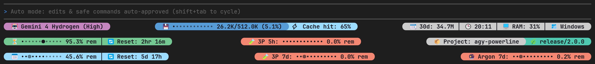
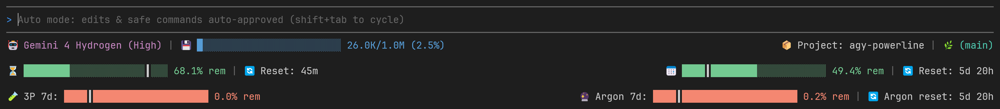

# agy-powerline

[English](README.md) | [简体中文](README.zh-CN.md) | [日本語](README.ja.md) | **Français** | [Español](README.es.md) | [한국어](README.ko.md) | [Deutsch](README.de.md)

[](https://www.npmjs.com/package/agy-powerline)
[](https://www.npmjs.com/package/agy-powerline)
[](https://github.com/wassim-azi/agy-powerline/stargazers)
[](https://github.com/wassim-azi/agy-powerline/actions/workflows/ci.yml)
[](https://github.com/wassim-azi/agy-powerline/actions/workflows/codeql.yml)
[](https://scorecard.dev/viewer/?uri=github.com/wassim-azi/agy-powerline)
[](https://www.bestpractices.dev/projects/15655)
[](#confidentialité-et-sécurité)
[](docs/install.md)
[](https://opensource.org/licenses/MIT)
[](https://codespaces.new/wassim-azi/agy-powerline?quickstart=1)
[](https://agy-powerline.com/configure/)
[](https://github.com/Piebald-AI/awesome-gemini-cli)

> **Remarque :** cette traduction peut ne pas être à jour. En cas de divergence, la [version anglaise](README.md) fait foi. La documentation détaillée ([`docs/`](docs/)) n’existe qu’en anglais.

**Une barre d’état rapide et configurable pour la CLI de Google Antigravity (`agy`).**

Consultez d’un coup d’œil le modèle utilisé, les quotas Gemini sur 5h/7j, ceux de Claude/GPT et d’Argon, la fenêtre de contexte, la branche Git et bien plus encore. Choisissez les widgets, les thèmes et la disposition dans un éditeur interactif. Une seule commande suffit pour l’installation, sans aucune dépendance.

<p align="center">
  
</p>

## Pourquoi agy-powerline ?

| Fonctionnalité             | Ce que vous obtenez                                                                                        | En savoir plus                                                                                                    |
| -------------------------- | ---------------------------------------------------------------------------------------------------------- | ----------------------------------------------------------------------------------------------------------------- |
| Rythme des quotas          | Des repères de rythme sur les jauges indiquent si votre quota 5h ou 7j tiendra jusqu’à sa réinitialisation | [Guide des quotas](docs/guides/antigravity-quota.md) · [Calculateur](https://agy-powerline.com/quota-calculator/) |
| Quotas multi-fournisseurs  | Suivez côte à côte les quotas Gemini 5h/7j, les modèles tiers (Claude/GPT) et Gemini 4 Argon               | [Référence du payload](docs/payload.md#quota-buckets)                                                             |
| Thèmes et dispositions     | 22 thèmes conformes WCAG AA (sombres, clairs et adaptés au daltonisme) pour `pills`, `lines` et `classic`  | [Galerie de thèmes](https://agy-powerline.com/themes/)                                                            |
| Configurateurs interactifs | Éditeur avec aperçu en direct dans le terminal (`npx agy-powerline configure`) ou dans le navigateur       | [Configurateur web](https://agy-powerline.com/configure/)                                                         |
| Sécurité et vie privée     | Aucune dépendance à l’exécution, aucun appel réseau, aucune télémétrie, sauvegarde de `settings.json`      | [Sécurité](SECURITY.md)                                                                                           |
| Multiplateforme            | Fonctionne sous Windows, macOS, Linux et WSL avec diagnostic intégré (`doctor`)                            | [Installation](docs/install.md) · [Dépannage](docs/troubleshooting.md)                                            |

## Installation

Vous avez besoin de [Node.js](https://nodejs.org/) 20 ou d’une version ultérieure, ainsi que de l’[interface en ligne de commande Antigravity](https://antigravity.google/docs/cli/overview). Compatible avec Windows, macOS, Linux et WSL ([remarques sur WSL](docs/install.md#wsl)).

```bash
npx agy-powerline             # installe la barre d’état et ouvre l’éditeur
agy                           # démarre Antigravity
```

Dans un terminal, `npx agy-powerline` installe les scripts (ou met à jour ceux qui ne sont plus à jour tout en conservant votre configuration), configure `settings.json` (après sauvegarde et demande de confirmation avant de remplacer un `statusLine` existant) et ouvre directement l’éditeur avec aperçu en direct. Redémarrez `agy` une fois ensuite. Pour une installation scriptée sans éditeur, utilisez `npx agy-powerline init --yes`. Pour en savoir plus, consultez [le fonctionnement de l’installation](docs/install.md).

<details>
<summary>Capture : la barre dans une vraie session agy (Windows Terminal)</summary>

<p align="center">
  
</p>

</details>

### Installer depuis agy

agy-powerline est aussi un plugin agy. Ajoutez-le, puis lancez sa compétence d’installation dans une session `agy` ; elle exécute `init` et `doctor` pour vous :

```text
agy plugin install https://github.com/wassim-azi/agy-powerline
/agy-powerline-setup
```

Redémarrez `agy` une fois ensuite. Détails : [la voie du plugin](docs/install.md#install-from-inside-agy-plugin).

Ou collez cette instruction dans une session `agy` :

```text
Install the agy-powerline statusline: run `npx agy-powerline init --yes`, then tell me to restart agy.
```

L’option `--yes` évite les questions auxquelles agy ne peut pas répondre et remplace toute configuration `statusLine` existante, après sauvegarde de `settings.json`.

Pour un terminal sans police Nerd Font, activez le mode ASCII (`Settings` via `i` dans `configure`).

## Personnalisation

`npx agy-powerline configure` ouvre un éditeur qui affiche un aperçu en temps réel de votre barre d’état. Utilisez `←` et `→` pour passer d’un onglet à l’autre (Widgets, Presets, Themes, Layout, Powerline, Settings) ; `↑` et `↓` pour vous déplacer ; Entrée pour sélectionner ; et `q` pour enregistrer et quitter. Les touches disponibles sont affichées en bas de chaque écran. La liste complète figure dans la [documentation de configuration](docs/configuration.md#configurator-keys).

Vous préférez le navigateur ? [Composez votre barre dans le navigateur](https://agy-powerline.com/configure/) avec un aperçu en direct, puis téléchargez-la ou importez-la.

Les modifications s’appliquent à une session `agy` en cours lors de l’actualisation suivante.

### Préréglages

Choisissez un préréglage comme point de départ, puis personnalisez-le :

| Préréglage | Informations affichées                                                                                                |
| ---------- | --------------------------------------------------------------------------------------------------------------------- |
| `default`  | Modèle, contexte et Git ; quotas sur 5h et 7j avec leurs réinitialisations sur une deuxième ligne                     |
| `compact`  | Une seule ligne : nom abrégé du modèle, quota le plus proche de sa limite, pourcentage du contexte et Git             |
| `agent`    | État de l’agent, sous-agents, titre, mode, sandbox ; modèle, contexte %, artefacts, quota le plus proche de sa limite |
| `git`      | Projet, branche, worktree, stash ; nombre de fichiers, lignes modifiées, commit                                       |
| `tokens`   | Tokens du contexte, tokens de la session en entrée et en sortie, cache hit ; tokens du jour et des 7 derniers jours   |
| `quotas`   | Offre et modèle ; quotas sur 5h et 7j côte à côte ; modèles tiers et Argon en dessous                                 |
| `full`     | Toutes les informations : session, projet et Git ; contexte, tokens et cache ; les deux quotas                        |

### Thèmes

| Fond du terminal        | Thèmes                                                                                                                                                                                                                                                          |
| ----------------------- | --------------------------------------------------------------------------------------------------------------------------------------------------------------------------------------------------------------------------------------------------------------- |
| Sombre                  | `dark-aurora` (par défaut), `dark-ocean`, `dark-ember`, `dark-forest`, `dark-neon`, `dark-mono`, `dark-dracula`, `dark-onyx`, `dark-tokyo-night`, `dark-catppuccin-macchiato`, `dark-catppuccin-frappe`, `dark-catppuccin-mocha`, `dark-nord`, `dark-rose-pine` |
| Clair                   | `light-paper`, `light-sky`, `light-sunset`, `light-cream`, `light-gruvbox`, `light-tokyo-night`                                                                                                                                                                 |
| Adapté au daltonisme    | `colorblind-dark`, `colorblind-light`                                                                                                                                                                                                                           |
| Couleurs personnalisées | `custom` ([mode d’emploi](docs/configuration.md#custom-theme))                                                                                                                                                                                                  |

Prévisualisez tous les thèmes dans la [galerie de thèmes](https://agy-powerline.com/themes/) ou avec `npx agy-powerline theme --gallery`. Pour appliquer un dégradé continu sur chaque ligne, ajoutez un dégradé : `npx agy-powerline gradient <name>` avec `aurora`, `sunset`, `ocean`, `forest`, `neon`, `candy`, `rainbow`, `mono` ou vos propres couleurs ([mode d’emploi](docs/configuration.md#gradients)).

### Dispositions

**Pills** (par défaut) : capsules de style powerline. Choisissez des formes arrondies, anguleuses, inclinées ou plates, et ajoutez éventuellement une ligne vide entre les lignes de la barre.

<p align="center">
  
</p>

<details>
<summary>Sur un terminal clair</summary>

<p align="center">
  
</p>

</details>

**Lines** : les mêmes informations sous forme de texte coloré classique.

<p align="center">
  
</p>

<details>
<summary>Sur un terminal clair</summary>

<p align="center">
  
</p>

</details>

**Classic** : du texte coloré séparé par des `|`, avec des jauges en blocs, comme `███░│░░░░░`.

<p align="center">
  
</p>

<details>
<summary>Sur un terminal clair</summary>

<p align="center">
  
</p>

</details>

### Langue de la barre

Les mots de la barre elle-même (`7j`, `Réinit`, `rest.`, les unités de `1j 17h`) peuvent s’afficher en français :

```sh
npx agy-powerline init --language fr
```

ou `"language": "fr"` dans `statusline.config.json` (`Settings` via `i` dans `configure`). Le nom du modèle, la branche et tout ce qu’envoie agy restent tels quels ; les commandes et `configure` restent en anglais. Détails dans la [documentation de configuration](docs/configuration.md#language).

## Widgets

| Widget                                                           | Informations affichées                                                                                                |
| ---------------------------------------------------------------- | --------------------------------------------------------------------------------------------------------------------- |
| `model`                                                          | Modèle utilisé                                                                                                        |
| `clock`                                                          | Heure locale (format 12h ou 24h réglé sous `clock`)                                                                   |
| `fiveHourBar`, `weeklyBar`                                       | Quota restant sur 5h/7j sous forme de jauge, avec un [repère de rythme](docs/configuration.md#quota-pace-marker)      |
| `fiveHourPct`, `weeklyPct`                                       | Pourcentage de quota restant sur 5h/7j                                                                                |
| `fiveHourReset`, `weeklyReset`                                   | Temps restant avant la réinitialisation du quota, ou heure de réinitialisation                                        |
| `quota`                                                          | Quota le plus proche de sa limite, avec son heure de réinitialisation                                                 |
| `thirdPartyFiveHour`, `thirdPartyWeekly`                         | Quotas des modèles tiers                                                                                              |
| `argonWeekly`, `argonReset`                                      | Quota hebdomadaire propre à Gemini 4 Argon (Google AI Pro) et sa réinitialisation                                     |
| `context`, `contextPct`, `contextTokens`                         | Fenêtre de contexte utilisée : jauge, pourcentage ou nombre de tokens                                                 |
| `git`                                                            | Branche, modifications non validées et commits en avance ou en retard                                                 |
| `gitChanges`, `gitFiles`, `gitSha`, `gitStash`, `gitWorktree`    | Lignes ajoutées et supprimées, fichiers indexés/modifiés/non suivis/en conflit, ID du commit, stashes, worktree lié   |
| `project`, `cwd`                                                 | Dossier du projet et dossier courant                                                                                  |
| `agent`, `agentState`, `plan`, `sandbox`, `artifacts`, `version` | Agent actif, état de l’agent (avec indicateur de confirmation), offre Antigravity, sandbox, artefacts, version de CLI |
| `tasks`, `queue`                                                 | Sous-agents actifs, tâches en arrière-plan et messages en file d’attente                                              |
| `mode`                                                           | Mode d’approbation (par exemple `accept-edits`) et mode Vim                                                           |
| `title`                                                          | Titre de la conversation                                                                                              |
| `sessionTime`                                                    | Temps écoulé depuis le début de la conversation active                                                                |
| `totalTokens`, `cost`, `cacheHit`, `cacheRead`, `cacheCreate`    | Tokens de la session, coût estimé (USD) et utilisation du cache des prompts                                           |
| `tokensToday`, `tokensWeek`                                      | Tokens utilisés aujourd’hui et sur les 7 derniers jours, toutes conversations confondues (Node 22.13+)                |
| `ram`                                                            | Mémoire utilisée sur votre machine                                                                                    |
| `os`                                                             | Système sur lequel agy tourne : Windows, macOS, Linux ou WSL                                                          |
| `host`                                                           | Utilisateur courant et nom d’hôte court du système (`alex@devbox`)                                                    |
| `customText`, `exec`                                             | Texte personnalisé ou résultat d’une [commande shell](docs/configuration.md#shell-command-widget-exec)                |

Un widget qui n’a rien à afficher se masque automatiquement. Vous pouvez personnaliser sa couleur, le renommer, changer son icône, masquer son libellé ou définir ses propres seuils d’alerte : consultez la [documentation de configuration](docs/configuration.md).

## Commandes

| Commande                                           | Fonction                                                                            |
| -------------------------------------------------- | ----------------------------------------------------------------------------------- |
| `npx agy-powerline`                                | Installer (si besoin), mettre à jour les scripts et ouvrir l’éditeur                |
| `npx agy-powerline init [--yes]`                   | Installer ou mettre à jour la barre d’état (prend en charge `--preset`, `--yes`, …) |
| `npx agy-powerline configure`                      | Ouvrir l’éditeur (alias `config`)                                                   |
| `npx agy-powerline preset <name>`                  | Appliquer un préréglage (`--list` pour afficher la liste)                           |
| `npx agy-powerline theme <name>`                   | Changer de thème (`--list`, `--gallery`)                                            |
| `npx agy-powerline gradient <name>`                | Colorer chaque ligne avec un dégradé (`--list`, `off`)                              |
| `npx agy-powerline layout <pills\|lines\|classic>` | Changer de disposition                                                              |
| `npx agy-powerline caps <style>`                   | Changer la forme des capsules : `round`, `angled`, `slanted`, `flat`                |
| `npx agy-powerline export [file]`                  | Enregistrer la configuration dans un fichier, pour la sauvegarder ou la partager    |
| `npx agy-powerline import <file>`                  | Charger une configuration, après avoir montré ce qui change (`--merge`)             |
| `npx agy-powerline doctor`                         | Vérifier l’installation et expliquer les éventuels problèmes                        |
| `npx agy-powerline report`                         | Générer un rapport de bogue respectueux de la vie privée                            |
| `npx agy-powerline uninstall [--delete]`           | Retirer la barre d’état d’agy (`--delete` supprime aussi ses fichiers)              |
| `npx agy-powerline render --demo`                  | Afficher la barre avec des données d’exemple                                        |

Utilisez l’option `--help` avec n’importe quelle commande pour afficher les options disponibles.

## Mise à jour

```bash
npx agy-powerline init --yes   # installe les scripts de la nouvelle version
npx agy-powerline doctor       # vérifie que tout est à jour
```

Vos paramètres sont conservés. Redémarrez ensuite `agy`.

## Dépannage

Commencez par exécuter `npx agy-powerline doctor` : cette commande vérifie l’installation et explique comment corriger les problèmes détectés. Retrouvez les problèmes courants et la procédure pour signaler un bogue dans le [guide de dépannage](docs/troubleshooting.md).

## Confidentialité et sécurité

- **Aucun appel réseau, aucune télémétrie.** Toutes les informations proviennent des données transmises par agy à la barre d’état, de `.git` et de votre système d’exploitation. Le seul lien externe est accessible avec la touche `g` dans `configure`, qui ouvre la page GitHub dans votre navigateur.
- **Vos paramètres sont protégés.** `init` et `uninstall` sauvegardent `settings.json` et refusent de modifier un fichier qu’ils ne parviennent pas à analyser.
- **Rien ne s’exécute sans que vous l’ayez ajouté.** À l’exception de brèves commandes `git` pour compter les commits en avance ou en retard ainsi que le nombre de fichiers et de lignes des widgets Git que vous ajoutez, les seules commandes exécutées par la barre sont celles des widgets `exec` que vous configurez vous-même.
- **Aucune dépendance à l’exécution**, avec une publication depuis la CI et une [attestation de provenance npm](https://docs.npmjs.com/generating-provenance-statements).

Pour plus de détails, consultez [SECURITY.md](SECURITY.md).

## Contribution

Les contributions sont les bienvenues. Commencez par lire [CONTRIBUTING.md](CONTRIBUTING.md) (installation de l’environnement de développement, architecture, ajout d’un widget ou d’un thème) et le [Code de conduite](CODE_OF_CONDUCT.md). Ouvrez vos pull requests vers la branche `main`. Signalez les bogues dans les [issues GitHub](https://github.com/wassim-azi/agy-powerline/issues) ou partagez vos idées et commentaires dans les [discussions](https://github.com/wassim-azi/agy-powerline/discussions).

Merci à toutes les personnes ayant contribué au projet :

<!-- ALL-CONTRIBUTORS-LIST:START - Do not remove or modify this section -->
<!-- prettier-ignore-start -->
<!-- markdownlint-disable -->
<table>
  <tbody>
    <tr>
      <td align="center" valign="top" width="20%"><a href="https://github.com/yatharth2soni"><br /><sub><b>Yatharth&nbsp;Soni</b></sub></a></td>
      <td align="center" valign="top" width="20%"><a href="https://github.com/dannyward630"><br /><sub><b>Danny&nbsp;Ward</b></sub></a></td>
      <td align="center" valign="top" width="20%"><a href="https://github.com/yoreva-01"><br /><sub><b>Yusuf&nbsp;Orçan</b></sub></a></td>
      <td align="center" valign="top" width="20%"><a href="https://github.com/yuefdev"><br /><sub><b>Yusuf&nbsp;Efe</b></sub></a></td>
      <td align="center" valign="top" width="20%"><a href="https://github.com/hiyouwhatsapp"><br /><sub><b>hiyouwhatsapp</b></sub></a></td>
    </tr>
    <tr>
      <td align="center" valign="top" width="20%"><a href="https://github.com/dharamdan01"><br /><sub><b>dharamdan01</b></sub></a></td>
      <td align="center" valign="top" width="20%"><a href="https://github.com/Ashuge11"><br /><sub><b>Ashvini&nbsp;Sundge</b></sub></a></td>
      <td align="center" valign="top" width="20%"><a href="https://www.unkletayo.dev/"><br /><sub><b>Adetayo&nbsp;Akinsanya</b></sub></a></td>
      <td align="center" valign="top" width="20%"><a href="https://github.com/rahul05ranjan"><br /><sub><b>Rahul</b></sub></a></td>
      <td align="center" valign="top" width="20%"><a href="https://github.com/Logic769"><br /><sub><b>Logic769</b></sub></a></td>
    </tr>
  </tbody>
</table>

<!-- markdownlint-restore -->
<!-- prettier-ignore-end -->

<!-- ALL-CONTRIBUTORS-LIST:END -->

Si agy-powerline vous est utile, une ⭐ permet à d’autres utilisateurs d’agy de le découvrir.

## Star History

[](https://star-history.com/#wassim-azi/agy-powerline&Date)

## Licence

[MIT](LICENSE) © Wassim AZI
