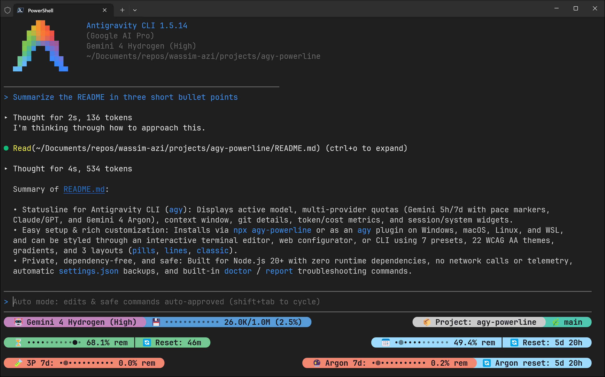
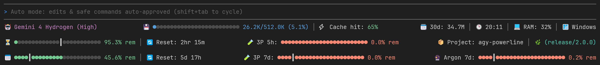

# agy-powerline

[English](README.md) | [简体中文](README.zh-CN.md) | **日本語** | [Français](README.fr.md) | [Español](README.es.md) | [한국어](README.ko.md) | [Deutsch](README.de.md)

[](https://www.npmjs.com/package/agy-powerline)
[](https://www.npmjs.com/package/agy-powerline)
[](https://github.com/wassim-azi/agy-powerline/stargazers)
[](https://github.com/wassim-azi/agy-powerline/actions/workflows/ci.yml)
[](https://github.com/wassim-azi/agy-powerline/actions/workflows/codeql.yml)
[](https://scorecard.dev/viewer/?uri=github.com/wassim-azi/agy-powerline)
[](https://www.bestpractices.dev/projects/15655)
[](#プライバシーとセキュリティ)
[](docs/install.md)
[](https://opensource.org/licenses/MIT)
[](https://codespaces.new/wassim-azi/agy-powerline?quickstart=1)
[](https://agy-powerline.com/configure/)
[](https://github.com/Piebald-AI/awesome-gemini-cli)

> この文書は英語版 [README](README.md) の翻訳で、最新の内容に追いついていない場合があります。内容が異なる場合は英語版が優先されます。詳しいドキュメント（[`docs/`](docs/)）は英語版のみです。

**Google Antigravity の CLI（`agy`）向けの、高速でカスタマイズ可能なステータスライン。**

使用中のモデル、Gemini の 5h/7d・Claude/GPT・Argon のクォータ、コンテキストウィンドウ、git ブランチなどがひと目でわかります。ウィジェット、テーマ、レイアウトは対話式のエディターで選べます。インストールはコマンドひとつ、依存パッケージはありません。

<p align="center">
  
</p>

## なぜ agy-powerline？

| 機能                         | できること                                                                                                          | 詳しく見る                                                                                                 |
| ---------------------------- | ------------------------------------------------------------------------------------------------------------------- | ---------------------------------------------------------------------------------------------------------- |
| クォータのペース表示         | クォータメーターのペースマーカーで、5h または 7d のクォータがリセットまでもつかがひと目でわかる                     | [クォータガイド](docs/guides/antigravity-quota.md) · [計算機](https://agy-powerline.com/quota-calculator/) |
| マルチプロバイダーのクォータ | Gemini 5h/7d、サードパーティ（Claude/GPT）、Gemini 4 Argon のクォータを横並びで追跡                                 | [ペイロードリファレンス](docs/payload.md#quota-buckets)                                                    |
| テーマ & レイアウト          | `pills`、`lines`、`classic` の各レイアウトで使える WCAG AA 準拠の 22 テーマ（ダーク、ライト、色覚多様性対応を含む） | [テーマギャラリー](https://agy-powerline.com/themes/)                                                      |
| 対話式のコンフィギュレーター | ターミナル（`npx agy-powerline`）またはブラウザーのライブプレビュー付きエディターで設定                             | [Web コンフィギュレーター](https://agy-powerline.com/configure/)                                           |
| セキュリティ & プライバシー  | ランタイム依存パッケージ 0、ネットワーク通信なし、テレメトリなし、`settings.json` の自動バックアップ                | [セキュリティ](SECURITY.md)                                                                                |
| クロスプラットフォーム       | 組み込みの診断機能（`doctor`）付きで Windows、macOS、Linux、WSL で動作                                              | [インストール](docs/install.md) · [トラブルシューティング](docs/troubleshooting.md)                        |

## インストール

[Node.js](https://nodejs.org/) 20 以上と [Antigravity CLI](https://antigravity.google/docs/cli/overview) が必要です。Windows、macOS、Linux、WSL で動作します（[WSL についての注意](docs/install.md#wsl)）。

```bash
npx agy-powerline             # ステータスラインをインストールしてエディターを開く
agy                           # Antigravity を起動
```

ターミナルで `npx agy-powerline` を実行すると、スクリプトをインストール（または設定を保ったまま古いスクリプトを更新）し、`settings.json` をバックアップして設定したうえで、ライブプレビュー付きエディターを開きます。完了後に `agy` を一度再起動してください。スクリプトでの自動インストールには `npx agy-powerline init --yes` を使います。詳細：[インストールの仕組み](docs/install.md)。

<details>
<summary>スクリーンショット：実際の agy セッションでのバー（Windows Terminal）</summary>

<p align="center">
  
</p>

</details>

### agy の中からインストールする

agy-powerline は agy のプラグインでもあります。追加してから `agy` セッション内でセットアップスキルを実行すると、`init` と `doctor` を自動で実行します：

```text
agy plugin install https://github.com/wassim-azi/agy-powerline
/agy-powerline-setup
```

完了後に `agy` を一度再起動してください。詳細：[プラグインでのインストール](docs/install.md#install-from-inside-agy-plugin)。

または、次の文を `agy` のセッションに貼り付けてください。

```text
Install the agy-powerline statusline: run `npx agy-powerline init --yes`, then tell me to restart agy.
```

`--yes` は agy が答えられない確認をスキップし、`settings.json` をバックアップしたうえで既存の `statusLine` を置き換えます。

Nerd Font のないターミナルでは、ASCII モードをオンにしてください（`npx agy-powerline` で `i` から `Settings` を開く）。

## カスタマイズ

`npx agy-powerline` を実行すると、バーのライブプレビュー付きのエディターが開きます。`←` `→` で Widgets、Presets、Themes、Layout、Powerline、Settings を切り替え、`↑` `↓` で移動、Enter で選択、`q` で保存して終了します。各画面のキーは画面下部に表示されます。キーの一覧は [Configuration](docs/configuration.md#configurator-keys) にあります。

ブラウザーの方がよければ、[ブラウザーでバーを作成](https://agy-powerline.com/configure/)してライブプレビューで確認し、ダウンロードまたはインポートできます。

変更は、実行中の `agy` の次回の更新時に反映されます。

### プリセット

プリセットから始めて、好みに合わせて調整します：

| プリセット | 表示内容                                                                                                                                             |
| ---------- | ---------------------------------------------------------------------------------------------------------------------------------------------------- |
| `default`  | モデル、コンテキスト、git；2 行目に 5h と 7d のクォータとリセットまでの時間                                                                          |
| `compact`  | 1 行：短いモデル名、最も残りの少ないクォータ、コンテキスト %、git                                                                                    |
| `agent`    | エージェントの状態、サブエージェント、タイトル、モード、サンドボックス；モデル、コンテキスト %、アーティファクト（成果物）、最も残りの少ないクォータ |
| `git`      | プロジェクト、ブランチ、worktree、stash；ファイル数、変更行数、コミット                                                                              |
| `tokens`   | コンテキストのトークン、セッションの入出力トークン、キャッシュヒット；今日と 7 日間のトークン                                                        |
| `quotas`   | プランとモデル；5h と 7d のクォータを横並びに、その下にサードパーティと Argon                                                                        |
| `full`     | すべて：セッション、プロジェクト、git；コンテキスト、トークン、キャッシュ；両方のクォータ                                                            |

### テーマ

| ターミナルの背景 | テーマ                                                                                                                                                                                                                                                           |
| ---------------- | ---------------------------------------------------------------------------------------------------------------------------------------------------------------------------------------------------------------------------------------------------------------- |
| ダーク           | `dark-aurora`（デフォルト）、`dark-ocean`、`dark-ember`、`dark-forest`、`dark-neon`、`dark-mono`、`dark-dracula`、`dark-onyx`、`dark-tokyo-night`、`dark-catppuccin-macchiato`、`dark-catppuccin-frappe`、`dark-catppuccin-mocha`、`dark-nord`、`dark-rose-pine` |
| ライト           | `light-paper`、`light-sky`、`light-sunset`、`light-cream`、`light-gruvbox`、`light-tokyo-night`                                                                                                                                                                  |
| 色覚多様性に配慮 | `colorblind-dark`、`colorblind-light`                                                                                                                                                                                                                            |
| 独自の配色       | `custom`（[方法](docs/configuration.md#custom-theme)）                                                                                                                                                                                                           |

すべてのテーマは[テーマギャラリー](https://agy-powerline.com/themes/)または `npx agy-powerline theme --gallery` でプレビューできます。各行にグラデーションをかけるには `npx agy-powerline gradient <name>` を使います（`aurora`、`sunset`、`ocean`、`forest`、`neon`、`candy`、`rainbow`、`mono`、または独自の配色を指定可能：[方法](docs/configuration.md#gradients)）。

### レイアウト

**Pills**（デフォルト）：powerline 風のカプセル。形は丸型、山型、斜め、フラットから選べ、行の間に空行を入れることもできます。

<p align="center">
  
</p>

<details>
<summary>明るいターミナルの場合</summary>

<p align="center">
  
</p>

</details>

**Lines**：同じ情報を色付きのプレーンテキストで表示します。

<p align="center">
  
</p>

<details>
<summary>明るいターミナルの場合</summary>

<p align="center">
  
</p>

</details>

**Classic**：`|` で区切ったプレーンな色付きテキストと、ブロックメーター（例：`███░│░░░░░`）。

<p align="center">
  
</p>

<details>
<summary>明るいターミナルの場合</summary>

<p align="center">
  
</p>

</details>

### バーの言語

バー自体の言葉（`リセット`、`残`、`コンテキスト` などのラベル）は日本語で表示できます：

```sh
npx agy-powerline init --language ja
```

または `statusline.config.json` に `"language": "ja"` と書きます（対話式エディターで `i` から `Settings` を開く）。モデル名、ブランチなど agy から届く内容はそのまま表示され、`2h 47m` の単位は幅を抑えるため英字のままです。コマンドと対話式エディターは英語のままです。詳しくは[設定のドキュメント](docs/configuration.md#language)をご覧ください。

## ウィジェット

| ウィジェット                                                     | 表示内容                                                                                                                             |
| ---------------------------------------------------------------- | ------------------------------------------------------------------------------------------------------------------------------------ |
| `model`                                                          | 使用中のモデル                                                                                                                       |
| `clock`                                                          | 現在の現地時刻（12/24 時間表記は `clock` で設定）                                                                                    |
| `fiveHourBar`、`weeklyBar`                                       | 5h / 7d クォータの残りをメーターで表示（[ペースマーカー](docs/configuration.md#quota-pace-marker)付き）                              |
| `fiveHourPct`、`weeklyPct`                                       | 5h / 7d クォータの残りをパーセントで表示                                                                                             |
| `fiveHourReset`、`weeklyReset`                                   | クォータがリセットされるまでの時間、またはリセット時刻                                                                               |
| `quota`                                                          | 最も早く尽きそうなクォータとそのリセット                                                                                             |
| `thirdPartyFiveHour`、`thirdPartyWeekly`                         | サードパーティモデルのクォータ                                                                                                       |
| `argonWeekly`、`argonReset`                                      | Gemini 4 Argon 専用の週間クォータ（Google AI Pro）とそのリセット                                                                     |
| `context`、`contextPct`、`contextTokens`                         | 使用中のコンテキストウィンドウ：メーター、パーセント、またはトークン数                                                               |
| `git`                                                            | ブランチ、未コミットの変更、ahead/behind                                                                                             |
| `gitChanges`、`gitFiles`、`gitSha`、`gitStash`、`gitWorktree`    | 追加・削除された行数、ステージ済/変更/未追跡/競合ファイル数、コミット ID、stash 数、リンクされた worktree                            |
| `project`、`cwd`                                                 | プロジェクトのフォルダー、現在のフォルダー                                                                                           |
| `agent`、`agentState`、`plan`、`sandbox`、`artifacts`、`version` | アクティブなエージェント、エージェントの状態（確認フラグ付き）、プラン、サンドボックス、アーティファクト（成果物）、CLI のバージョン |
| `tasks`、`queue`                                                 | 実行中のサブエージェント、バックグラウンドタスク、待機中のユーザーメッセージ                                                         |
| `mode`                                                           | 承認モード（例：accept-edits）と Vim モード                                                                                          |
| `title`                                                          | 会話のタイトル                                                                                                                       |
| `sessionTime`                                                    | アクティブな会話が始まってからの経過時間                                                                                             |
| `totalTokens`、`cost`、`cacheHit`、`cacheRead`、`cacheCreate`    | セッションのトークン数、推定コスト（USD）、プロンプトキャッシュの使用状況                                                            |
| `tokensToday`、`tokensWeek`、`tokensMonth`                       | 今日、過去 7 日間、過去 30 日間のトークン使用量（すべての会話、Node 22.13 以降）                                                     |
| `ram`                                                            | マシンのメモリ使用量                                                                                                                 |
| `os`                                                             | agy が動作しているシステム：Windows、macOS、Linux、または WSL                                                                        |
| `host`                                                           | OS の現在のユーザーと短いホスト名（`alex@devbox`）                                                                                   |
| `customText`、`env`、`exec`                                      | 任意のテキスト、環境変数、または [シェルコマンド](docs/configuration.md#shell-command-widget-exec)の出力                             |

表示する内容のないウィジェットは自動的に隠れます。ウィジェットごとに色や名前・アイコンを変えたり、ラベルを外したり、独自の警告しきい値を設定したりできます。詳しくは [Configuration](docs/configuration.md) を参照してください。

## コマンド

| コマンド                                           | 内容                                                                       |
| -------------------------------------------------- | -------------------------------------------------------------------------- |
| `npx agy-powerline`                                | インストール（必要時）、スクリプト更新、エディター起動                     |
| `npx agy-powerline init [--yes]`                   | ステータスラインをインストールまたは更新（`--preset`、`--yes` などに対応） |
| `npx agy-powerline configure`                      | エディターを開く（非推奨・別名 `config`、`npx agy-powerline` を推奨）      |
| `npx agy-powerline preset <name>`                  | プリセットを適用（一覧は `--list`）                                        |
| `npx agy-powerline theme <name>`                   | テーマを切り替え（`--list`、`--gallery`）                                  |
| `npx agy-powerline gradient <name>`                | 各行にグラデーションを適用（`--list`、`off`）                              |
| `npx agy-powerline layout <pills\|lines\|classic>` | レイアウトを切り替え                                                       |
| `npx agy-powerline caps <style>`                   | カプセルの形を切り替え：`round`、`angled`、`slanted`、`flat`               |
| `npx agy-powerline export [file]`                  | 設定をファイルに保存（バックアップや共有用）                               |
| `npx agy-powerline import <file>`                  | 変更内容を表示したうえで設定を読み込む（`--merge`）                        |
| `npx agy-powerline doctor`                         | インストールを確認し、問題を説明                                           |
| `npx agy-powerline report`                         | プライバシーに配慮したバグレポートを作成                                   |
| `npx agy-powerline uninstall [--delete]`           | agy から削除（`--delete` でファイルも削除）                                |
| `npx agy-powerline render --demo`                  | サンプルデータでバーを表示                                                 |

各コマンドのオプションは `--help` で確認できます。

## 更新

```bash
npx agy-powerline init --yes   # 新しいバージョンのスクリプトをインストール
npx agy-powerline doctor       # すべてが最新か確認
```

設定はそのまま残ります。更新後に `agy` を再起動してください。

## トラブルシューティング

まず `npx agy-powerline doctor` を実行してください。インストールを確認し、見つかった問題の直し方を教えてくれます。よくある問題とバグの報告方法：[Troubleshooting](docs/troubleshooting.md)。

## プライバシーとセキュリティ

- **ネットワーク通信なし、テレメトリなし。** 表示する情報はすべて、agy がバーに渡すデータ、`.git`、OS から取得します。外部へのリンクは対話式エディターの `g` だけで、ブラウザーで GitHub のページを開きます。
- **設定は安全です。** `init` と `uninstall` は `settings.json` をバックアップし、解析できないファイルは編集しません。
- **追加しない限り何も実行されません。** ahead/behind の数や、追加した git ウィジェットのファイル数・行数を数えるための短い `git` の呼び出しを除き、バーが実行するコマンドは自分で設定した `exec` ウィジェットだけです。
- **ランタイム依存パッケージはゼロ**で、CI から [npm provenance](https://docs.npmjs.com/generating-provenance-statements) 付きで公開されています。

詳細：[SECURITY.md](SECURITY.md)。

## コントリビュート

コントリビュートを歓迎します。まず [CONTRIBUTING.md](CONTRIBUTING.md)（セットアップ、アーキテクチャ、ウィジェットやテーマの追加）と [Code of Conduct](CODE_OF_CONDUCT.md) をお読みください。プルリクエストは `main` に向けて作成してください。バグは [GitHub issues](https://github.com/wassim-azi/agy-powerline/issues) で報告し、アイデアやフィードバックは [Discussions](https://github.com/wassim-azi/agy-powerline/discussions) で共有してください。

コントリビューターの皆さんに感謝します：

<!-- ALL-CONTRIBUTORS-LIST:START - Do not remove or modify this section -->
<!-- prettier-ignore-start -->
<!-- markdownlint-disable -->
<table>
  <tbody>
    <tr>
      <td align="center" valign="top" width="20%"><a href="https://github.com/yatharth2soni"><br /><sub><b>Yatharth&nbsp;Soni</b></sub></a></td>
      <td align="center" valign="top" width="20%"><a href="https://github.com/dannyward630"><br /><sub><b>Danny&nbsp;Ward</b></sub></a></td>
      <td align="center" valign="top" width="20%"><a href="https://github.com/yoreva-01"><br /><sub><b>Yusuf&nbsp;Orçan</b></sub></a></td>
      <td align="center" valign="top" width="20%"><a href="https://github.com/yuefdev"><br /><sub><b>Yusuf&nbsp;Efe</b></sub></a></td>
      <td align="center" valign="top" width="20%"><a href="https://github.com/hiyouwhatsapp"><br /><sub><b>hiyouwhatsapp</b></sub></a></td>
    </tr>
    <tr>
      <td align="center" valign="top" width="20%"><a href="https://github.com/dharamdan01"><br /><sub><b>dharamdan01</b></sub></a></td>
      <td align="center" valign="top" width="20%"><a href="https://github.com/Ashuge11"><br /><sub><b>Ashvini&nbsp;Sundge</b></sub></a></td>
      <td align="center" valign="top" width="20%"><a href="https://www.unkletayo.dev/"><br /><sub><b>Adetayo&nbsp;Akinsanya</b></sub></a></td>
      <td align="center" valign="top" width="20%"><a href="https://github.com/rahul05ranjan"><br /><sub><b>Rahul</b></sub></a></td>
      <td align="center" valign="top" width="20%"><a href="https://github.com/Logic769"><br /><sub><b>Logic769</b></sub></a></td>
    </tr>
  </tbody>
</table>

<!-- markdownlint-restore -->
<!-- prettier-ignore-end -->

<!-- ALL-CONTRIBUTORS-LIST:END -->

agy-powerline が役に立ったら、⭐ を付けていただけると他の agy ユーザーにも見つけてもらいやすくなります。

## Star History

[](https://star-history.com/#wassim-azi/agy-powerline&Date)

## ライセンス

[MIT](LICENSE) © Wassim AZI
