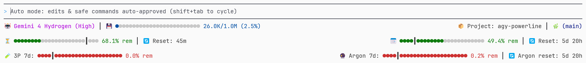

<div align="center">

# agy-powerline

[English](README.md) | [简体中文](README.zh-CN.md) | [日本語](README.ja.md) | [Français](README.fr.md) | [Español](README.es.md) | **한국어** | [Deutsch](README.de.md)

[](https://www.npmjs.com/package/agy-powerline)
[](https://www.npmjs.com/package/agy-powerline)
[](https://github.com/wassim-azi/agy-powerline/stargazers)
[](https://github.com/wassim-azi/agy-powerline/actions/workflows/ci.yml)
[](https://github.com/wassim-azi/agy-powerline/actions/workflows/codeql.yml)
[](https://scorecard.dev/viewer/?uri=github.com/wassim-azi/agy-powerline)
[](#개인정보-및-보안)
[](docs/install.md)
[](https://opensource.org/licenses/MIT)
[](https://agy-powerline.com/configure/)
[](https://github.com/Piebald-AI/awesome-gemini-cli)

> 이 문서는 영어 원본 [README](README.md)의 번역이며, 원본보다 오래된 내용일 수 있습니다. 내용이 다를 경우 영어 원본이 우선합니다. 상세 문서([`docs/`](docs/))는 영어로만 제공됩니다.

**Google Antigravity CLI를 위한 빠르고 자유롭게 설정 가능한 agy 스테이터스라인.**

사용 중인 모델, Google Gemini(Hydrogen, Neon, Argon, Carbon, Flash) 및 Anthropic(Claude, Sonnet) 할당량, 컨텍스트 창, git 브랜치 등을 한눈에 확인하세요. 인터랙티브 에디터에서 위젯, 테마, 레이아웃을 선택하세요. 명령 한 번으로 설치되며, 의존성은 없습니다.

</div>

<p align="center">
  
</p>

## 왜 agy-powerline인가요?

| 기능             | 제공 내용                                                                                             | 자세히 보기                                                                                               |
| ---------------- | ----------------------------------------------------------------------------------------------------- | --------------------------------------------------------------------------------------------------------- |
| 할당량 속도 표시 | 할당량 미터의 페이스 마커로 5시간 또는 7일 할당량이 리셋 전까지 유지되는지 확인                       | [할당량 가이드](docs/guides/antigravity-quota.md) · [계산기](https://agy-powerline.com/quota-calculator/) |
| 다중 모델 할당량 | Google Gemini(Hydrogen, Neon, Argon, Carbon, Flash) 및 Anthropic(Claude, Sonnet) 할당량을 나란히 추적 | [페이로드 레퍼런스](docs/payload.md#quota-buckets)                                                        |
| 테마 & 레이아웃  | `pills`, `lines`, `classic` 전반에서 WCAG AA 대비를 통과한 22개 테마(다크, 라이트, 색약 친화 포함)    | [테마 갤러리](https://agy-powerline.com/themes/)                                                          |
| 인터랙티브 설정  | 터미널(`npx agy-powerline`) 또는 브라우저에서 실시간 미리보기 에디터로 설정                           | [웹 설정기](https://agy-powerline.com/configure/)                                                         |
| 보안 & 개인정보  | 런타임 의존성 0, 네트워크 호출 없음, 텔레메트리 없음, `settings.json` 자동 백업                       | [보안](SECURITY.md)                                                                                       |
| 크로스 플랫폼    | 내장 진단 도구(`doctor`)와 함께 Windows, macOS, Linux, WSL 지원                                       | [설치](docs/install.md) · [문제 해결](docs/troubleshooting.md)                                            |

## 설치

[Node.js](https://nodejs.org/) 20 이상과 [Antigravity CLI](https://antigravity.google/docs/cli/overview)가 필요합니다. Windows, macOS, Linux, WSL에서 동작합니다([WSL 관련 참고](docs/install.md#wsl)).

```bash
npx agy-powerline             # 스테이터스라인을 설치하고 에디터 열기
agy                           # Antigravity 시작
```

터미널에서 `npx agy-powerline`을 실행하면 스크립트를 설치(또는 설정을 유지한 채 오래된 스크립트를 업데이트)하고, `settings.json`을 백업한 뒤 연결한 다음 실시간 미리보기 에디터를 엽니다. 이후 `agy`를 한 번 재시작하세요. 스크립트 자동 설치에는 `npx agy-powerline init --yes`를 사용하세요. 자세한 내용: [설치 동작 방식](docs/install.md).

<details>
<summary>스크린샷: 실제 agy 세션의 바 (Windows Terminal)</summary>

<p align="center">
  
</p>

</details>

### agy 안에서 설치하기

agy-powerline은 agy 플러그인이기도 합니다. 플러그인으로 추가한 뒤 `agy` 세션에서 설치 스킬을 실행하면, `init`과 `doctor`를 대신 실행해 줍니다:

```text
agy plugin install https://github.com/wassim-azi/agy-powerline
/agy-powerline-setup
```

이후 `agy`를 한 번 재시작하세요. 자세한 내용: [플러그인 설치 경로](docs/install.md#install-from-inside-agy-plugin).

또는 `agy` 세션에 이렇게 붙여넣으세요.

```text
Install the agy-powerline statusline: run `npx agy-powerline init --yes`, then tell me to restart agy.
```

`--yes`는 agy가 답할 수 없는 프롬프트를 건너뛰고, `settings.json`을 백업한 뒤 기존 `statusLine`을 교체합니다.

Nerd Font가 없는 터미널에서는 ASCII 모드를 켜세요(`npx agy-powerline`에서 `i`로 `Settings` 열기).

## 커스터마이즈

`npx agy-powerline`을 실행하면 바의 실시간 미리보기가 있는 에디터가 열립니다. `←` `→`로 Widgets, Presets, Themes, Layout, Powerline, Settings 탭을 전환하고, `↑` `↓`로 이동, Enter로 선택, `q`로 저장하고 종료합니다. 각 화면의 키는 하단에 표시되며, 전체 목록은 [Configuration](docs/configuration.md#configurator-keys)에 있습니다.

브라우저를 선호하나요? [브라우저에서 바 만들기](https://agy-powerline.com/configure/)에서 실시간 미리보기로 구성한 뒤 다운로드하거나 가져올 수 있습니다.

변경 사항은 실행 중인 `agy`의 다음 갱신 시점에 적용됩니다.

### 프리셋

프리셋에서 시작한 뒤 조정하세요:

| 프리셋    | 표시 내용                                                                                                         |
| --------- | ----------------------------------------------------------------------------------------------------------------- |
| `default` | 모델, 컨텍스트, git; 두 번째 행에 리셋 시간이 있는 5시간/7일 할당량                                               |
| `compact` | 한 줄: 짧은 모델명, 남은 양이 가장 적은 할당량, 컨텍스트 %, git                                                   |
| `agent`   | 에이전트 상태, 서브에이전트, 제목, 모드, 샌드박스; 모델, 컨텍스트 %, 아티팩트(산출물), 남은 양이 가장 적은 할당량 |
| `git`     | 프로젝트, 브랜치, 워크트리, 스태시; 파일 수, 변경 줄 수, 커밋                                                     |
| `tokens`  | 컨텍스트 토큰, 세션 토큰 입/출력, 캐시 적중; 오늘 및 최근 7일간 토큰                                              |
| `quotas`  | 요금제(플랜)와 모델; 5시간/7일 할당량 나란히; 아래에 서드파티와 Argon                                             |
| `full`    | 전부: 세션, 프로젝트, git; 컨텍스트, 토큰, 캐시; 양쪽 할당량                                                      |

### 테마

| 터미널 배경 | 테마                                                                                                                                                                                                                                                        |
| ----------- | ----------------------------------------------------------------------------------------------------------------------------------------------------------------------------------------------------------------------------------------------------------- |
| 다크        | `dark-aurora` (기본값), `dark-ocean`, `dark-ember`, `dark-forest`, `dark-neon`, `dark-mono`, `dark-dracula`, `dark-onyx`, `dark-tokyo-night`, `dark-catppuccin-macchiato`, `dark-catppuccin-frappe`, `dark-catppuccin-mocha`, `dark-nord`, `dark-rose-pine` |
| 라이트      | `light-paper`, `light-sky`, `light-sunset`, `light-cream`, `light-gruvbox`, `light-tokyo-night`                                                                                                                                                             |
| 색약 친화   | `colorblind-dark`, `colorblind-light`                                                                                                                                                                                                                       |
| 직접 지정   | `custom` ([방법](docs/configuration.md#custom-theme))                                                                                                                                                                                                       |

모든 테마는 [테마 갤러리](https://agy-powerline.com/themes/) 또는 `npx agy-powerline theme --gallery`에서 미리 볼 수 있습니다. 각 행에 걸쳐 색이 이어지는 그라데이션을 넣으려면 `npx agy-powerline gradient <name>`을 사용하세요. `aurora`, `sunset`, `ocean`, `forest`, `neon`, `candy`, `rainbow`, `mono` 또는 직접 지정한 색을 쓸 수 있습니다([방법](docs/configuration.md#gradients)).

### 레이아웃

**Pills** (기본값): 파워라인 스타일 캡슐. 둥근(round), 각진(angled), 기울어진(slanted), 평평한(flat) 모양을 고를 수 있고, 행 사이에 빈 줄을 넣을 수도 있습니다.

<p align="center">
  
</p>

<details>
<summary>라이트 터미널에서</summary>

<p align="center">
  
</p>

</details>

**Lines**: 같은 정보를 단순한 색 텍스트로 표시합니다.

<p align="center">
  
</p>

<details>
<summary>라이트 터미널에서</summary>

<p align="center">
  
</p>

</details>

**Classic**: `|` 구분자와 `███░│░░░░░` 같은 블록 미터가 있는 단순 색 텍스트입니다.

<p align="center">
  
</p>

<details>
<summary>라이트 터미널에서</summary>

<p align="center">
  
</p>

</details>

### 상태바 언어

바 자체의 텍스트(`리셋`, `남음`, `컨텍스트`, `서브에이전트` 등의 레이블)를 한국어로 표시할 수 있습니다:

```sh
npx agy-powerline init --language ko
```

또는 `statusline.config.json`에 `"language": "ko"`를 설정하세요(인터랙티브 에디터에서 `i`로 `Settings` 열기). 모델명, 브랜치 등 agy가 전달하는 값은 그대로 표시되며, `2h 47m` 같은 시간 단위는 폭을 줄이기 위해 영문 약어를 유지합니다. CLI 출력과 인터랙티브 에디터 화면은 영어로 유지됩니다. 자세한 내용은 [언어 설정 문서](docs/configuration.md#language)를 참고하세요.

## 위젯

| 위젯                                                             | 표시 내용                                                                                            |
| ---------------------------------------------------------------- | ---------------------------------------------------------------------------------------------------- |
| `model`                                                          | 사용 중인 모델                                                                                       |
| `clock`                                                          | 현재 현지 시각(12/24시간 형식은 `clock`에서 설정)                                                    |
| `fiveHourBar`, `weeklyBar`                                       | 남은 5시간/7일 할당량을 미터로 표시, [페이스 마커](docs/configuration.md#quota-pace-marker) 포함     |
| `fiveHourPct`, `weeklyPct`                                       | 남은 5시간/7일 할당량을 백분율로 표시                                                                |
| `fiveHourReset`, `weeklyReset`                                   | 할당량이 리셋되기까지 남은 시간 또는 리셋 시각                                                       |
| `quota`                                                          | 가장 먼저 소진될 가능성이 높은 할당량과 리셋 시각                                                    |
| `thirdPartyFiveHour`, `thirdPartyWeekly`                         | 서드파티 모델 할당량                                                                                 |
| `argonWeekly`, `argonReset`                                      | Gemini 4 Argon 자체 주간 할당량(Google AI Pro)과 리셋                                                |
| `context`, `contextPct`, `contextTokens`                         | 사용 중인 컨텍스트 창: 미터, 백분율 또는 토큰 수                                                     |
| `git`                                                            | 브랜치, 커밋되지 않은 변경, ahead/behind                                                             |
| `gitChanges`, `gitFiles`, `gitSha`, `gitStash`, `gitWorktree`    | 추가/삭제된 줄, 스테이지/수정/추적 안 됨/충돌 파일 수, 커밋 ID, 스태시, 연결된 워크트리              |
| `project`, `cwd`                                                 | 프로젝트 폴더, 현재 폴더                                                                             |
| `agent`, `agentState`, `plan`, `sandbox`, `artifacts`, `version` | 활성 에이전트, 에이전트 상태(확인 플래그 포함), 요금제(플랜), 샌드박스, 아티팩트(산출물), CLI 버전   |
| `tasks`, `queue`                                                 | 실행 중인 서브에이전트, 백그라운드 작업, 대기 중인 메시지                                            |
| `mode`                                                           | 승인 모드(예: accept-edits)와 Vim 모드                                                               |
| `title`                                                          | 대화 제목                                                                                            |
| `sessionTime`                                                    | 활성 대화가 시작된 이후 경과 시간                                                                    |
| `totalTokens`, `cost`, `cacheHit`, `cacheRead`, `cacheCreate`    | 세션 토큰, 예상 비용(USD), 프롬프트 캐시 사용량                                                      |
| `tokensToday`, `tokensWeek`, `tokensMonth`                       | 오늘, 최근 7일 및 최근 30일간 사용한 토큰, 모든 대화 포함(Node 22.13+)                               |
| `ram`                                                            | 시스템 메모리 사용량                                                                                 |
| `os`                                                             | agy가 동작하는 시스템: Windows, macOS, Linux 또는 WSL                                                |
| `host`                                                           | OS의 현재 사용자와 짧은 호스트명(`alex@devbox`)                                                      |
| `customText`, `env`, `exec`                                      | 직접 입력한 텍스트, 환경 변수 또는 [셸 명령](docs/configuration.md#shell-command-widget-exec)의 출력 |

표시할 내용이 없는 위젯은 스스로 숨습니다. 위젯은 색, 이름, 아이콘을 바꾸고 라벨을 없애거나 자체 알림 임계값을 지정할 수 있습니다. [Configuration](docs/configuration.md)을 참고하세요.

## 명령

| 명령                                               | 하는 일                                                                   |
| -------------------------------------------------- | ------------------------------------------------------------------------- |
| `npx agy-powerline`                                | 설치(필요 시), 스크립트 업데이트 및 에디터 열기                           |
| `npx agy-powerline init [--yes]`                   | 스테이터스라인 설치 또는 업데이트(`--preset`, `--yes` 등 지원)            |
| `npx agy-powerline configure`                      | 에디터 열기(지원 중단 예정; `config` 별칭, `npx agy-powerline` 사용 권장) |
| `npx agy-powerline preset <name>`                  | 프리셋 적용(`--list`로 목록 확인)                                         |
| `npx agy-powerline theme <name>`                   | 테마 전환(`--list`, `--gallery`)                                          |
| `npx agy-powerline gradient <name>`                | 각 행을 그라데이션으로 색칠(`--list`, `off`)                              |
| `npx agy-powerline layout <pills\|lines\|classic>` | 레이아웃 전환                                                             |
| `npx agy-powerline caps <style>`                   | 캡슐 모양 전환: `round`, `angled`, `slanted`, `flat`                      |
| `npx agy-powerline export [file]`                  | 구성을 파일로 저장, 백업하거나 공유할 때 사용                             |
| `npx agy-powerline import <file>`                  | 변경 내용을 보여준 뒤 구성 불러오기(`--merge`)                            |
| `npx agy-powerline doctor`                         | 설치 상태 확인과 문제 설명                                                |
| `npx agy-powerline report`                         | 개인정보를 포함하지 않는 버그 리포트 작성                                 |
| `npx agy-powerline uninstall [--delete]`           | agy에서 제거(`--delete`는 파일도 삭제)                                    |
| `npx agy-powerline render --demo`                  | 샘플 데이터로 바 출력                                                     |

모든 명령은 `--help`로 옵션을 확인할 수 있습니다.

## 업데이트

```bash
npx agy-powerline init --yes   # 새 버전의 스크립트 설치
npx agy-powerline doctor       # 모든 것이 최신인지 확인
```

설정은 유지됩니다. 이후 `agy`를 재시작하세요.

## 문제 해결

먼저 `npx agy-powerline doctor`를 실행하세요. 설치를 점검하고 해결 방법을 알려줍니다. 일반적인 문제와 버그 신고 방법: [Troubleshooting](docs/troubleshooting.md).

## 개인정보 및 보안

- **네트워크 요청 없음, 텔레메트리 없음.** 모든 정보는 agy가 바에 넘겨주는 데이터, `.git`, OS에서 옵니다. 외부 링크는 인터랙티브 에디터의 `g` 하나뿐이며, 브라우저에서 GitHub 페이지를 엽니다.
- **설정은 안전합니다.** `init`과 `uninstall`은 `settings.json`을 백업하고, 해석할 수 없는 파일은 편집하지 않습니다.
- **직접 추가하지 않는 한 아무것도 실행되지 않습니다.** ahead/behind 개수와 git 위젯의 파일/줄 수를 세는 짧은 `git` 호출 외에, 바가 실행하는 명령은 직접 설정한 `exec` 위젯뿐입니다.
- **런타임 의존성 0**, CI에서 [npm provenance](https://docs.npmjs.com/generating-provenance-statements)와 함께 게시됩니다.

자세한 내용: [SECURITY.md](SECURITY.md).

## 기여

기여를 환영합니다. [CONTRIBUTING.md](CONTRIBUTING.md)(설정, 아키텍처, 위젯/테마 추가)와 [Code of Conduct](CODE_OF_CONDUCT.md)부터 읽어보세요. 풀 리퀘스트는 `main` 브랜치로 보내주세요. 버그는 [GitHub issues](https://github.com/wassim-azi/agy-powerline/issues)에, 아이디어와 피드백은 [Discussions](https://github.com/wassim-azi/agy-powerline/discussions)에 남겨주세요.

기여해 주신 모든 분들께 감사드립니다:

<!-- ALL-CONTRIBUTORS-LIST:START - Do not remove or modify this section -->
<!-- prettier-ignore-start -->
<!-- markdownlint-disable -->
<table>
  <tbody>
    <tr>
      <td align="center" valign="top" width="20%"><a href="https://github.com/yatharth2soni"><br /><sub><b>Yatharth&nbsp;Soni</b></sub></a></td>
      <td align="center" valign="top" width="20%"><a href="https://github.com/dannyward630"><br /><sub><b>Danny&nbsp;Ward</b></sub></a></td>
      <td align="center" valign="top" width="20%"><a href="https://github.com/yoreva-01"><br /><sub><b>Yusuf&nbsp;Orçan</b></sub></a></td>
      <td align="center" valign="top" width="20%"><a href="https://github.com/yuefdev"><br /><sub><b>Yusuf&nbsp;Efe</b></sub></a></td>
      <td align="center" valign="top" width="20%"><a href="https://github.com/hiyouwhatsapp"><br /><sub><b>hiyouwhatsapp</b></sub></a></td>
    </tr>
    <tr>
      <td align="center" valign="top" width="20%"><a href="https://github.com/dharamdan01"><br /><sub><b>dharamdan01</b></sub></a></td>
      <td align="center" valign="top" width="20%"><a href="https://github.com/Ashuge11"><br /><sub><b>Ashvini&nbsp;Sundge</b></sub></a></td>
      <td align="center" valign="top" width="20%"><a href="https://www.unkletayo.dev/"><br /><sub><b>Adetayo&nbsp;Akinsanya</b></sub></a></td>
      <td align="center" valign="top" width="20%"><a href="https://github.com/rahul05ranjan"><br /><sub><b>Rahul</b></sub></a></td>
      <td align="center" valign="top" width="20%"><a href="https://github.com/Logic769"><br /><sub><b>Logic769</b></sub></a></td>
    </tr>
  </tbody>
</table>

<!-- markdownlint-restore -->
<!-- prettier-ignore-end -->

<!-- ALL-CONTRIBUTORS-LIST:END -->

agy-powerline이 유용했다면 ⭐를 눌러 주세요. 다른 agy 사용자가 찾는 데 도움이 됩니다.

## Star History

[](https://star-history.com/#wassim-azi/agy-powerline&Date)

## 라이선스

[MIT](LICENSE) © Wassim AZI
