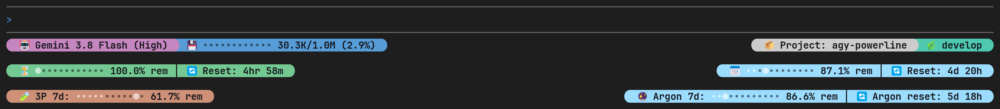
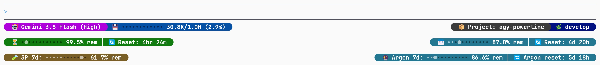
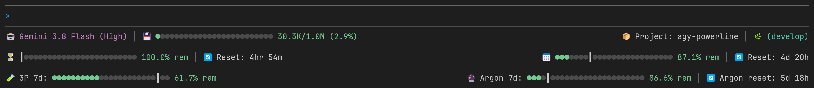
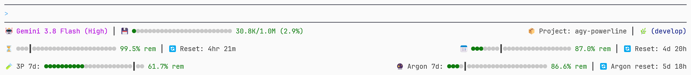

# agy-powerline

[English](README.md) | **简体中文** | [日本語](README.ja.md)

[](https://github.com/wassim-azi/agy-powerline/actions/workflows/ci.yml)
[](https://www.npmjs.com/package/agy-powerline)
[](https://nodejs.org/)
[](https://opensource.org/licenses/MIT)
[](#隐私与安全)

> 本文译自英文版 [README](README.md)，可能落后于英文版；如有出入，以英文版为准。详细文档（[`docs/`](docs/)）仅提供英文版。

**为 Google Antigravity CLI（`agy`）打造的快速、可配置的状态栏。**

一眼看到当前模型、Gemini 5h/7d 配额、上下文窗口、git 分支等信息。在交互式编辑器中挑选组件、主题和布局。一条命令即可安装，零依赖。

<p align="center">
  
</p>

## 安装

需要 [Node.js](https://nodejs.org/) 20+ 和 [Antigravity CLI](https://antigravity.google/docs/cli/overview)。支持 Windows、macOS、Linux 和 WSL（[WSL 说明](docs/install.md#wsl)）。

```bash
npx agy-powerline init        # 将状态栏安装到 agy
npx agy-powerline configure   # 可选：挑选组件、主题和布局
agy                           # 启动 Antigravity
```

`init` 在替换任何内容之前都会先询问，并会先备份 Antigravity 的 `settings.json`。运行 `init` 后需重启一次 `agy`。详情：[`init` 做了什么](docs/install.md)。

如果终端没有 Nerd Font，可以开启 ASCII 模式（在 `configure` 中按 `i`）。

## 自定义

`npx agy-powerline configure` 会打开一个带有状态栏实时预览的编辑器。用 `←` `→` 在 Widgets、Presets、Themes、Layout 和 Powerline 之间切换，`↑` `↓` 移动，Enter 选择，`q` 保存并退出。每个界面的按键都显示在底部；完整列表见 [Configuration](docs/configuration.md#configurator-keys)。

正在运行的 `agy` 会在下次刷新时应用更改。

### 预设

从一个预设开始，再按需调整：

| 预设        | 显示内容                                               |
| ----------- | ------------------------------------------------------ |
| `default`   | 模型、上下文、git；第二行显示 5h 和 7d 配额及重置时间  |
| `compact`   | 单行：简短模型名、最紧张的配额、上下文 %、git          |
| `workspace` | 项目、git、代理状态、模型；上下文、最紧张的配额和模式  |
| `limits`    | 所有配额（5h、7d、第三方、Argon），每行一个            |
| `full`      | 全部：会话、项目和 git；上下文、token 和缓存；两组配额 |

### 主题

| 终端背景   | 主题                                                                                                                                   |
| ---------- | -------------------------------------------------------------------------------------------------------------------------------------- |
| 深色       | `dark-aurora`（默认）、`dark-ocean`、`dark-ember`、`dark-forest`、`dark-neon`、`dark-mono`、`dark-nocturne`、`dark-onyx`、`dark-metro` |
| 浅色       | `light-paper`、`light-sky`、`light-sunset`、`light-cream`                                                                              |
| 色盲友好   | `colorblind-dark`、`colorblind-light`                                                                                                  |
| 自定义颜色 | `custom`（[方法](docs/configuration.md#custom-theme)）                                                                                 |

用 `npx agy-powerline theme --gallery` 预览所有主题。

### 布局

**Pills**（默认）：powerline 风格的胶囊。可选圆角、尖角、斜角或平直形状，也可以在行与行之间留一个空行。

<p align="center">
  
</p>

**Lines**：以纯彩色文本显示相同的信息。

<p align="center">
  
  
</p>

## 组件

| 组件                                                    | 显示内容                                                                             |
| ------------------------------------------------------- | ------------------------------------------------------------------------------------ |
| `model`                                                 | 当前使用的模型                                                                       |
| `fiveHourBar`、`weeklyBar`                              | 以进度条显示 5h / 7d 剩余配额，带[进度标记](docs/configuration.md#quota-pace-marker) |
| `fiveHourPct`、`weeklyPct`                              | 以百分比显示 5h / 7d 剩余配额                                                        |
| `fiveHourReset`、`weeklyReset`                          | 距配额重置的时间，或重置时刻                                                         |
| `quota`                                                 | 最接近用完的配额及其重置时间                                                         |
| `thirdPartyFiveHour`、`thirdPartyWeekly`                | 第三方模型的配额                                                                     |
| `argonWeekly`、`argonReset`                             | Gemini 4 Argon 独立的每周配额（Google AI Pro）及其重置时间                           |
| `context`、`contextPct`、`contextTokens`                | 已用的上下文窗口：进度条、百分比或 token 数                                          |
| `git`                                                   | 分支、未提交的更改以及领先/落后的提交数                                              |
| `project`、`cwd`                                        | 项目文件夹、当前文件夹                                                               |
| `agentState`、`plan`、`sandbox`、`artifacts`、`version` | 代理正在做什么、你的套餐、沙箱、产物、CLI 版本                                       |
| `tasks`                                                 | 正在运行的子代理和后台任务                                                           |
| `mode`                                                  | 审批模式（如 accept-edits）和 Vim 模式                                               |
| `title`                                                 | 对话标题                                                                             |
| `totalTokens`、`cacheHit`、`cacheRead`、`cacheCreate`   | 会话 token 数和提示缓存的使用情况                                                    |
| `ram`                                                   | 本机已用内存                                                                         |
| `customText`、`exec`                                    | 你自己的文本，或 [shell 命令](docs/configuration.md#shell-command-widget-exec)的输出 |

没有内容可显示的组件会自动隐藏。组件可以更改颜色、去掉标签，或设置自己的告警阈值：见 [Configuration](docs/configuration.md)。

## 命令

| 命令                                      | 作用                                               |
| ----------------------------------------- | -------------------------------------------------- |
| `npx agy-powerline init [--yes]`          | 安装或更新状态栏                                   |
| `npx agy-powerline configure`             | 打开编辑器（别名 `config`）                        |
| `npx agy-powerline preset <name>`         | 应用预设（`--list` 查看全部）                      |
| `npx agy-powerline theme <name>`          | 切换主题（`--list`、`--gallery`）                  |
| `npx agy-powerline layout <pills\|lines>` | 切换布局                                           |
| `npx agy-powerline caps <style>`          | 切换胶囊形状：`round`、`angled`、`slanted`、`flat` |
| `npx agy-powerline doctor`                | 检查安装并说明问题所在                             |
| `npx agy-powerline report`                | 生成保护隐私的错误报告                             |
| `npx agy-powerline uninstall [--delete]`  | 从 agy 中移除（`--delete` 会同时删除其文件）       |
| `npx agy-powerline render --demo`         | 用示例数据打印状态栏                               |

任何命令加上 `--help` 即可查看其选项。

## 更新

```bash
npx agy-powerline init --yes   # 安装新版本的脚本
npx agy-powerline doctor       # 检查一切是否为最新
```

你的设置会被保留。更新后请重启 `agy`。

## 故障排查

请先运行 `npx agy-powerline doctor`：它会检查安装，并告诉你如何修复发现的问题。常见问题以及如何报告错误：[Troubleshooting](docs/troubleshooting.md)。

## 隐私与安全

- **无网络请求，无遥测。** 所有信息都来自 agy 传给状态栏的数据、`.git` 和你的操作系统。唯一的对外链接是 `configure` 中的 `g`，它会在浏览器中打开 GitHub 页面。
- **你的设置是安全的。** `init` 和 `uninstall` 会备份 `settings.json`，并拒绝编辑无法解析的文件。
- **你不添加，就不会运行任何命令。** 除了一次用于计算领先/落后提交数的快速 `git` 调用外，状态栏只会运行你自己配置的 `exec` 组件。
- **零运行时依赖**，通过 CI 发布并附带 [npm provenance](https://docs.npmjs.com/generating-provenance-statements)。

完整说明：[SECURITY.md](SECURITY.md)。

## 参与贡献

欢迎贡献。请先阅读 [CONTRIBUTING.md](CONTRIBUTING.md)（环境搭建、架构、添加组件或主题）和 [Code of Conduct](CODE_OF_CONDUCT.md)。Pull request 请提交到 `develop` 分支。在 [GitHub issues](https://github.com/wassim-azi/agy-powerline/issues) 中报告错误，或在 [Discussions](https://github.com/wassim-azi/agy-powerline/discussions) 中分享想法和反馈。

## 许可证

[MIT](LICENSE) © Wassim AZI
